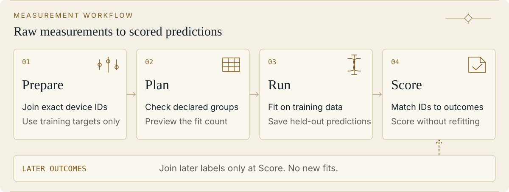

<p align="center"></p>

<h1 id="axiom-clotho" align="center"><picture><source media="(prefers-color-scheme: dark)" srcset="https://raw.githubusercontent.com/xinhi6716/xinhi6716/443d48c713f27d52656ad8ea3cb4c5bb9c7dd440/assets/brand-marks/v1/clotho-icon-dark.svg"></picture> Axiom Clotho</h1>

<p align="center"><strong>Local models and reproducible evaluation for grouped semiconductor data.</strong></p>
<p align="center"><strong>English</strong> · <a href="README.zh-TW.md">繁體中文</a></p>

Use Clotho to turn supported RRAM or FET measurements into device-level features, or start with a feature CSV. Keep related devices, wafers or batches together when evaluating a model. Save predictions before joining later outcomes.

| Start with | Use |
| --- | --- |
| A first run or a feature table | [Python quick start](#begin) · [Grouped CSV example](#tabular-start) |
| Raw measurements in a supported schema | [RRAM and FET workflow](#thread) |
| A small local build without Python | [Native Rust on `main`](#native-rust) |
| Saved predictions or a prior run | [Outputs and verification](#evidence) |

<a id="begin"></a>
<a id="get-the-reviewed-beta-core"></a>
<a id="choose-the-version-you-mean"></a>

<a id="start-here"></a>

## Python quick start

Use Python 3.10+ in a clean environment. **The tagged Python beta and current source are separate:** the [v0.3.0b7 release](https://github.com/xinhi6716/axiom-clotho/releases/tag/v0.3.0b7) is frozen; `main` contains later Python and native Rust work.

```bash
git clone --branch v0.3.0b7 https://github.com/xinhi6716/axiom-clotho.git clotho-source
cd clotho-source
python -m venv .venv
# POSIX; on Windows Command Prompt: .venv\Scripts\activate.bat
. .venv/bin/activate
python -m pip install .
clotho --version
```

<a id="try-the-demo"></a>

### Make your first report

```bash
clotho tabular demo --out runs/demo
```

Open `runs/demo/report.html`. The demo fits models on invented data. Use a fresh output directory for each run. The distribution is `ml-super-calculator`; the compatible CLI names are `clotho`, `mlcalc`, `groupbench` and `mlcalc-workflow`. Dependency installation may need network access; the modelling workflow runs locally.

**Release wheel:** verify the matching wheel against the release's `SHA256SUMS.txt`. The [installation guide](docs/RELEASE_NOTES_0.3.0b7.md#installation-and-reproducible-example) explains offline installation when compatible dependencies are already present. The example CSVs are in the source archive, not the wheel.

<a id="tabular-start"></a>
<a id="bring-your-data"></a>
<a id="plan-first-then-fit"></a>

<a id="start-from-your-own-table"></a>

## Evaluate a grouped CSV

From the tagged source checkout:

```bash
mlcalc plan run examples/synthetic_materials.csv --target response --group batch \
  --features temperature_c,pressure_mpa,duration_min,material_family
mlcalc run examples/synthetic_materials.csv --target response --group batch \
  --features temperature_c,pressure_mpa,duration_min,material_family --out runs/grouped
```

`plan run` previews the split and fit count without fitting. `run` holds declared groups apart and fits preprocessing on training partitions. For your own CSV, replace the path, target, group and features; exclude IDs, notes and columns unavailable at prediction time.

<a id="predict-new-rows-after-evaluation"></a>

| Task | Entry point |
| --- | --- |
| Numeric outcome | `mlcalc run`: default comparison includes Dummy mean, Ridge and Extra Trees. |
| Binary outcome | `mlcalc binary`: explicit 0/1 workflow with Dummy, Logistic and Extra Trees. [Binary guide](docs/BINARY_PROTOCOL.md) |
| Predict new rows | `mlcalc predict`: select and refit on labelled training data, then predict from a feature-only CSV. This step does not return a new test score. [Prediction guide](docs/USAGE_REFERENCE.md#predict-new-rows) |

<a id="thread"></a>
<a id="what-this-beta-completes"></a>
<a id="four-stage-quickstart"></a>

## From measurements to predictions

<picture>
  <source media="(prefers-color-scheme: dark) and (max-width: 600px)" srcset="docs/assets/clotho-workflow-en-dark-mobile.svg">
  <source media="(max-width: 600px)" srcset="docs/assets/clotho-workflow-en-light-mobile.svg">
  <source media="(prefers-color-scheme: dark)" srcset="docs/assets/clotho-workflow-en-dark.svg">
  
</picture>

| Supported input | Start here |
| --- | --- |
| RRAM I–V measurements | Summarize resistance at a fixed condition, one row per device. [Complete RRAM example](examples/measurement-regression/README.md) |
| FET transfer curves in the canonical schema | Extract criterion VGS and windowed log-current slope from one declared acquisition per lot, wafer and device. [Complete FET example](examples/fet-device-regression/README.md) |

```bash
clotho init --workflow rram --out my-measurements
```

Use `--workflow fet` for the FET template. `init` writes headers, configuration and a checklist, without inventing measurements or inferring units. Fill in those files, then use `prepare`, `plan` and `run`. Only `score` takes the prediction cohort's later outcomes; it joins saved predictions and does not refit. [Input setup](docs/WORKFLOW_INIT.md) · [Measurement protocol](docs/INTEGRATED_MEASUREMENT_WORKFLOW.md)

<a id="native-rust"></a>

## Native Rust on `main`

Start in a separate **current-source checkout** of `main`, not the frozen b7 tag. Rust 1.70+ is required. The first Cargo fetch needs dependency access; the locked build and examples can run offline.

```bash
git clone --branch main https://github.com/xinhi6716/axiom-clotho.git clotho-native
cd clotho-native
cargo fetch --manifest-path rust/Cargo.toml --locked
cargo build --manifest-path rust/Cargo.toml --release --locked --offline
rust/target/release/clotho evaluate \
  --csv rust/clotho-cli/examples/synthetic_process.csv --target synthetic_response \
  --features anneal_temperature_c,film_thickness_nm \
  --group wafer --folds 4 --model ridge --alpha 1 --out native-ridge
```

Run the binary by path to distinguish it from the Python command with the same name. On Windows, the executable is `clotho.exe`. The CSV is a synthetic arithmetic example.

| Available on `main` | Details |
| --- | --- |
| `fit`, `predict`, `evaluate` | Mean, Ridge and kNN regression; documented binary and mixed-feature paths. [Native guide](docs/RUST_NATIVE_WORKFLOW.md) · [kNN target arithmetic](docs/RUST_KNN_BASELINE.md) · [Binary and mixed data](docs/RUST_BINARY_AND_MIXED.md) |
| Bounded nested regression | Tune on inner group folds; reserve outer groups for scoring. [Nested selection](docs/RUST_NESTED_SELECTION.md) |
| `extract-fet`, `extract-rram`, `prepare-measurements` | Native extraction and preparation use their own documented file schemas. [FET](docs/RUST_FET_EXTRACTION.md) · [RRAM](docs/RUST_RRAM_EXTRACTION.md) · [Preparation](docs/RUST_MEASUREMENT_PREPARATION.md) |
| `compare-saved` | Recompute RMSE and baseline-relative MSE skill from three aligned series without fitting. A zero-error baseline leaves skill undefined. [Saved-series contract](docs/RUST_BASELINE_SKILL.md#fit-free-declared-series-cli) |

Default native saved model specifications include selected training rows. Keep them private. The [opt-in Mean summary](docs/RUST_NATIVE_WORKFLOW.md#opt-in-mean-inference-summary) stores summary statistics instead. Python run bundles are not native Rust artifacts; consult the [migration inventory](docs/RUST_MIGRATION_STATUS.md) for exact coverage. Separate release environments are recommended; see the [beta migration notes](docs/CLOTHO_BETA_MIGRATION.md).

<a id="evidence"></a>
<a id="read-the-results"></a>

## Read and verify outputs

| Run | Look for |
| --- | --- |
| Python tabular | `report.html`, `summary.json`, `predictions.csv`. The HTML has English / 繁體中文 controls. |
| Python measurements | `prediction_rows.csv` for device-keyed predictions. The separate score step produces a report against later observations. |
| Native grouped evaluation | `predictions.csv`, `metrics.json`, and the final `COMPLETE` marker. Treat an output directory without the marker as incomplete. |

[Saved outputs and offline verification](docs/USAGE_REFERENCE.md#outputs): `mlcalc verify` checks artifact bytes on platforms with POSIX no-follow access. Checksums, [query-byte binding](docs/RUST_BASELINE_SKILL.md#opt-in-exact-query-byte-binding-v2) and declared IDs can make an analysis easier to reproduce; they do not establish physical independence or provenance. Reports can contain targets, predictions and IDs; inspect before sharing.

<a id="limits"></a>
<a id="know-the-boundaries"></a>
<a id="horizon"></a>

<a id="know-the-limits"></a>

## Scope and limits

- Choose groups from the study design. Distinct names alone do not guarantee independent wafers, chips or sources. Compare row-weighted and group-weighted errors when group sizes differ.
- Measurement routes support specified schemas and regression. Clotho does not infer physical units, establish causality, or guarantee performance on new devices. Example data are synthetic.
- Representation and size limits differ across the Python and native paths. Check source precision before fitting, and see [numeric and resource limits](docs/USAGE_REFERENCE.md#limits-to-understand-before-trusting-a-result) and [native input limits](docs/RUST_NATIVE_WORKFLOW.md#data-contract).

<a id="find-your-next-step"></a>

## Reference

- [Examples](examples/README.md) · [Python reference](docs/USAGE_REFERENCE.md) · [Evaluation protocol](docs/PROTOCOL.md) · [Python API](docs/USAGE_REFERENCE.md#python-api)
- Current-source examples: [optional grouped models](examples/optional_grouped_study_v1/README.md), [domain-inner evaluation](examples/domain-inner-tabular/README.md), [forward-window planner](docs/GROUP_FORWARD_WINDOW_PLAN.md), [fixed forward baselines](docs/GROUP_FORWARD_BASELINE_EVALUATION.md), [saved intervals](docs/SAVED_INTERVAL_EVALUATION.md), [RRAM write-pair intake audit](docs/RRAM_WRITE_PAIR_AUDIT.md), [joint dependency groups](examples/joint-dependency-tabular/README.md).
- [Releases](https://github.com/xinhi6716/axiom-clotho/releases) · [Roadmap](ROADMAP.md) · [Contributing](CONTRIBUTING.md) · [Security](SECURITY.md) · [References](docs/REFERENCES.md)

Source and synthetic generators: [MIT](LICENSE). Dependencies keep their own licenses. [Artwork notices](docs/assets/CLOTHO_EDITORIAL_NOTICES.md).

Part of **Moirai** · [Axiom](https://github.com/xinhi6716) · [Chronos](https://github.com/xinhi6716/axiom-chronos) · [Atropos](https://github.com/xinhi6716/axiom-atropos)

<details>
<summary>Earlier section links</summary>

<a id="run-the-demo"></a>
- [Run the demo](docs/USAGE_REFERENCE.md#run-the-demo)

<a id="distinguish-missing-values-from-literal-marker-strings"></a>
- [Distinguish missing values from literal marker strings](docs/USAGE_REFERENCE.md#distinguish-missing-values-from-literal-marker-strings)

<a id="source-companion-fixed-environment-feature-comparison"></a>
- [Source companion: fixed environment feature comparison](docs/USAGE_REFERENCE.md#source-companion-fixed-environment-feature-comparison)

<a id="runnable-semiconductor-integration"></a>
- [Runnable semiconductor integration](docs/USAGE_REFERENCE.md#runnable-semiconductor-integration)

<a id="simulation-only-causal-design-rehearsal"></a>
- [Simulation-only causal-design rehearsal](docs/USAGE_REFERENCE.md#simulation-only-causal-design-rehearsal)

<a id="explicit-binary-passfail-workflow-unreleased"></a>
- [Explicit binary pass/fail workflow (prerelease)](docs/USAGE_REFERENCE.md#explicit-binary-passfail-workflow-unreleased)

<a id="use-your-own-regression-data"></a>
- [Use your own regression data](docs/USAGE_REFERENCE.md#use-your-own-regression-data)

<a id="preview-the-work-before-fitting"></a>
- [Preview the work before fitting](docs/USAGE_REFERENCE.md#preview-the-work-before-fitting)

<a id="predict-new-rows"></a>
- [Predict new rows](docs/USAGE_REFERENCE.md#predict-new-rows)

<a id="check-whether-new-inputs-were-observed-in-training"></a>
- [Check whether new inputs were observed in training](docs/USAGE_REFERENCE.md#check-whether-new-inputs-were-observed-in-training)

<a id="reuse-a-declared-feature-schema"></a>
- [Reuse a declared feature schema](docs/USAGE_REFERENCE.md#reuse-a-declared-feature-schema)

<a id="python-api"></a>
- [Python API](docs/USAGE_REFERENCE.md#python-api)

<a id="how-the-evaluation-is-split-and-scored"></a>
- [How the evaluation is split and scored](docs/USAGE_REFERENCE.md#how-the-evaluation-is-split-and-scored)

<a id="baselines-and-resource-budget"></a>
- [Baselines and resource budget](docs/USAGE_REFERENCE.md#baselines-and-resource-budget)

<a id="outputs"></a>
- [Outputs](docs/USAGE_REFERENCE.md#outputs)

<a id="verify-an-existing-bundle-offline"></a>
- [Verify an existing bundle offline](docs/USAGE_REFERENCE.md#verify-an-existing-bundle-offline)

<a id="limits-to-understand-before-trusting-a-result"></a>
- [Limits to understand before trusting a result](docs/USAGE_REFERENCE.md#limits-to-understand-before-trusting-a-result)

<a id="design-inspiration-not-copied-modeling"></a>
- [Design inspiration, not copied modeling](docs/USAGE_REFERENCE.md#design-inspiration-not-copied-modeling)

<a id="develop"></a>
- [Develop](docs/USAGE_REFERENCE.md#develop)

<a id="compare-saved-validation-budgets-locally"></a>
- [Compare saved validation budgets locally](docs/USAGE_REFERENCE.md#compare-saved-validation-budgets-locally)

<a id="optional-saved-prediction-consistency"></a>
- [Optional saved prediction consistency](docs/USAGE_REFERENCE.md#optional-saved-prediction-consistency)

</details>
