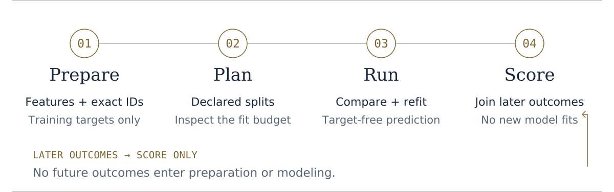

<p align="right"><strong>English</strong> · <a href="README.zh-TW.md">繁體中文</a></p>

<h1 id="axiom-clotho" align="center">Axiom Clotho</h1>

<p align="center"></p>

<p align="center"><strong>Device measurements. Grouped models. Local reports.</strong></p>

Clotho turns supported RRAM and FET measurement tables into device-level features, compares models with your declared groups held apart, and predicts outcomes for new devices. Or start from a table.

**[Beta 0.3.0b7](https://github.com/xinhi6716/axiom-clotho/releases/tag/v0.3.0b7)** · [Quick start](#begin) · [Measurements](#thread) · [Your table](#tabular-start) · [Reports](#evidence) · [Limits](#limits)

### Choose your starting point

| I have… | Start with… |
| --- | --- |
| No dataset yet | [A small synthetic demo](#try-the-demo) |
| RRAM or FET measurements | [The measurement workflow](#thread) |
| A feature table | [Grouped tabular modelling](#tabular-start) |
| Saved predictions | [Reports and evaluation](#evidence) |

<a id="begin"></a>
<a id="get-the-reviewed-beta-core"></a>
<a id="choose-the-version-you-mean"></a>

## Start here

Use Python 3.10+ and a fresh environment. The tagged source includes the example files:

```bash
git clone https://github.com/xinhi6716/axiom-clotho.git clotho-source
cd clotho-source
git checkout --detach v0.3.0b7
python -m venv .venv
# POSIX; on Windows use .venv\Scripts\activate instead.
. .venv/bin/activate
python -m pip install -e .
clotho --version
```

Installation may download build and runtime dependencies. Clotho's calculations run locally, without an account, hosted ML API or model-weight download. The package remains **`ml-super-calculator`**; `mlcalc`, `groupbench` and existing Python imports are kept for compatibility. [Installation and compatibility](docs/CLOTHO_BETA_MIGRATION.md).

<a id="try-the-demo"></a>

### Make your first report

```bash
clotho tabular demo --out runs/demo
```

Open **`runs/demo/report.html`**. This fits models on a small invented table. Use a new output path for each example. The older `clotho demo` is a different fixed semiconductor walkthrough; use `clotho tabular demo` for this first report.

<details>
<summary>Install a release wheel instead</summary>

Download the wheel and `SHA256SUMS.txt` from the [b7 release](https://github.com/xinhi6716/axiom-clotho/releases/tag/v0.3.0b7), then verify the checksum. In an environment that already has compatible dependencies:

```bash
python -m pip install --no-index --no-deps ./ml_super_calculator-0.3.0b7-py3-none-any.whl
clotho --version
```

Required dependencies are `numpy>=1.24,<3`, `pandas>=2,<3`, `scikit-learn>=1.4,<2` and `threadpoolctl>=3,<4`. These are supported version bounds, not a fully tested matrix. The command above will not fetch missing packages. Extract the matching source archive for the example CSVs. No PyPI publication is implied. [Full installation guide](docs/RELEASE_NOTES_0.3.0b7.md#installation-and-reproducible-example).

</details>

<a id="thread"></a>
<a id="what-this-beta-completes"></a>
<a id="four-stage-quickstart"></a>

## From measurements to predictions

**Prepare → Plan → Run → Score.** Keep training endpoints separate from the later outcomes used to evaluate predictions.

<picture>
  <source media="(prefers-color-scheme: dark) and (max-width: 600px)" srcset="docs/assets/clotho-ritual-process-dark-mobile.svg">
  <source media="(max-width: 600px)" srcset="docs/assets/clotho-ritual-process-light-mobile.svg">
  <source media="(prefers-color-scheme: dark)" srcset="docs/assets/clotho-ritual-process-dark.svg">
  
</picture>

| Your input | Supported route |
| --- | --- |
| RRAM I–V measurements | Resistance features at a fixed declared condition, one row per device. [RRAM example](examples/measurement-regression/README.md) |
| Canonical FET transfer curves | One declared acquisition per `(lot, wafer, device)`, with criterion VGS and windowed log slope. [FET example](examples/fet-device-regression/README.md) |
| Your own measurement files | `clotho init` creates blank CSV headers, an unfinished configuration and a checklist. [Input setup](docs/WORKFLOW_INIT.md) |

```bash
clotho init --workflow rram --out my-measurements
# For FET inputs, use --workflow fet.
```

`init` does not create sample measurements, guess units or fit models. Fill in the files and declarations before running `prepare`.

<details>
<summary>Run the complete RRAM example</summary>

From the tagged checkout or matching source archive, with fresh output directories:

```bash
clotho prepare \
  --input-dir examples/measurement-regression/fixtures/raw \
  --partitions examples/measurement-regression/fixtures/partitions.csv \
  --training-targets examples/measurement-regression/fixtures/training_targets.csv \
  --config examples/measurement-regression/fixtures/config.json \
  --output-dir clotho-prepared

clotho plan --prepared clotho-prepared
clotho run --prepared clotho-prepared --output-dir clotho-run

# Only scoring accepts the prediction cohort's later outcomes.
clotho score --run-dir clotho-run \
  --outcomes examples/measurement-regression/fixtures/later_outcomes.csv \
  --output-dir clotho-evaluation
```

The invented fixture has **18 devices: 12 training and 6 prediction**, with disjoint declared batches. `plan` reports **40 planned fits** without training. `run` fits the models and saves predictions; `score` evaluates all six later outcomes with **no additional fits**. These counts check the workflow, not real-device accuracy. [Inputs, outputs and expected results](examples/measurement-regression/README.md).

</details>

<a id="tabular-start"></a>
<a id="bring-your-data"></a>
<a id="plan-first-then-fit"></a>

## Start from your own table

Choose a numeric target, a group column such as batch or wafer, and an explicit list of predictors available before the outcome. Numeric and categorical features are supported, including missing feature values.

```bash
mlcalc plan run measurements.csv \
  --target mobility --group wafer_batch \
  --features temperature_c,pressure_mpa,duration_min,material_family

mlcalc run measurements.csv \
  --target mobility --group wafer_batch \
  --features temperature_c,pressure_mpa,duration_min,material_family \
  --out runs/mobility
```

The plan checks inputs and reports the proposed splits, candidates and fit count without training. Regression compares **Dummy mean, Ridge and Extra Trees**, with preprocessing and model selection inside training partitions.

Use `--features` or `--features-file` to exclude IDs, notes and post-outcome measurements. Without an allowlist, every column other than the target and group becomes a predictor. Supply comma-separated UTF-8 CSVs with decimal points; decimal commas are not converted automatically.

<a id="predict-new-rows-after-evaluation"></a>

For new predictions, provide a second CSV containing exactly the selected features, without target or group columns. Prediction selects and refits models on the labeled training data; it does not produce a new test score. [Prediction guide](docs/USAGE_REFERENCE.md#predict-new-rows).

For 0/1 outcomes, explicitly choose `mlcalc binary`; the default command remains regression. The binary route compares Dummy, Logistic and Extra Trees with a fixed 0.5 decision threshold. [Binary workflow](docs/BINARY_PROTOCOL.md) · [All examples](examples/README.md) · [Python API](docs/USAGE_REFERENCE.md#python-api).

<a id="evidence"></a>
<a id="read-the-results"></a>

## Read the results

| Open | What you get |
| --- | --- |
| `report.html` | Model comparisons, group-level errors and links to saved results. |
| Measurement run: `prediction_rows.csv` | Device-keyed predictions, before later outcomes are supplied. |
| Measurement score: `report.html` | A separate evaluation of saved predictions against later observations. |
| Tabular run: `summary.json`, `predictions.csv` | Metrics, observed values, predictions and fold assignments. |

Tabular reports offer **English / 繁體中文** controls; measurement summary pages are English in this beta. Language changes do not alter saved numbers. Review IDs, targets and predictions before sharing reports or committing run folders.

See the [report guide](docs/USAGE_REFERENCE.md#outputs) for manifests, checksums and verification. `mlcalc verify` checks saved file bytes without fitting, but requires POSIX no-follow file access; a passing checksum does not establish scientific validity or authenticity.

<a id="limits"></a>
<a id="know-the-boundaries"></a>
<a id="horizon"></a>

## Know the limits

- **Groups are your declaration.** Holding batch labels apart does not reveal hidden dependencies or establish transfer to a new domain.
- **Measurement support is specific.** RRAM and FET routes use their documented schemas and features; they are not general instrument-file importers. Measurement workflows currently support regression only.
- **Predictions need independent evaluation.** Clotho does not provide causal identification, calibrated uncertainty, physical-unit validation or guaranteed extrapolation. Invented examples are teaching data.
- **Inputs and compute are bounded differently.** File, row and feature limits reject unsupported inputs; they are not hard memory or runtime quotas. [Input and resource limits](docs/USAGE_REFERENCE.md#limits-to-understand-before-trusting-a-result).

Version b7 refreshes the Clotho artwork, report presentation and documentation. It retains the b6 check that rejects nonfinite fitted regression ExtraTrees state; workflows, models, splits and metrics are unchanged. [Release notes](docs/RELEASE_NOTES_0.3.0b7.md). Broader domain modules remain on the [roadmap](ROADMAP.md).

## Find your next step

[Examples](examples/README.md) · [Measurement inputs](docs/CLOTHO_CSV_BETA.md) · [Evaluation protocol](docs/PROTOCOL.md) · [Full reference](docs/USAGE_REFERENCE.md) · [Contributing](CONTRIBUTING.md) · [Security](SECURITY.md)

<details>
<summary>Older releases and section links</summary>

For rollback, use the matching release guide in a separate environment. Historical tags and downloads stay unchanged: [b6](docs/RELEASE_NOTES_0.3.0b6.md), [b5](docs/RELEASE_NOTES_0.3.0b5.md), [b4](docs/RELEASE_NOTES_0.3.0b4.md), [b3](docs/RELEASE_NOTES_0.3.0b3.md), [b2](docs/RELEASE_NOTES_0.3.0b2.md), [b1](docs/RELEASE_NOTES_0.3.0b1.md), [a4](https://github.com/xinhi6716/axiom-clotho/releases/tag/v0.2.0a4). New installations should use b7; b1 has a known inventory-path issue.

<a id="run-the-demo"></a>

- [Run the demo](docs/USAGE_REFERENCE.md#run-the-demo)

<a id="distinguish-missing-values-from-literal-marker-strings"></a>

- [Distinguish missing values from literal marker strings](docs/USAGE_REFERENCE.md#distinguish-missing-values-from-literal-marker-strings)

<a id="source-companion-fixed-environment-feature-comparison"></a>

- [Source companion: fixed environment feature comparison](docs/USAGE_REFERENCE.md#source-companion-fixed-environment-feature-comparison)

<a id="runnable-semiconductor-integration"></a>

- [Runnable semiconductor integration](docs/USAGE_REFERENCE.md#runnable-semiconductor-integration)

<a id="simulation-only-causal-design-rehearsal"></a>

- [Simulation-only causal-design rehearsal](docs/USAGE_REFERENCE.md#simulation-only-causal-design-rehearsal)

<a id="explicit-binary-passfail-workflow-unreleased"></a>

- [Explicit binary pass/fail workflow (prerelease)](docs/USAGE_REFERENCE.md#explicit-binary-passfail-workflow-unreleased)

<a id="use-your-own-regression-data"></a>

- [Use your own regression data](docs/USAGE_REFERENCE.md#use-your-own-regression-data)

<a id="preview-the-work-before-fitting"></a>

- [Preview the work before fitting](docs/USAGE_REFERENCE.md#preview-the-work-before-fitting)

<a id="predict-new-rows"></a>

- [Predict new rows](docs/USAGE_REFERENCE.md#predict-new-rows)

<a id="check-whether-new-inputs-were-observed-in-training"></a>

- [Check whether new inputs were observed in training](docs/USAGE_REFERENCE.md#check-whether-new-inputs-were-observed-in-training)

<a id="reuse-a-declared-feature-schema"></a>

- [Reuse a declared feature schema](docs/USAGE_REFERENCE.md#reuse-a-declared-feature-schema)

<a id="python-api"></a>

- [Python API](docs/USAGE_REFERENCE.md#python-api)

<a id="how-the-evaluation-is-split-and-scored"></a>

- [How the evaluation is split and scored](docs/USAGE_REFERENCE.md#how-the-evaluation-is-split-and-scored)

<a id="baselines-and-resource-budget"></a>

- [Baselines and resource budget](docs/USAGE_REFERENCE.md#baselines-and-resource-budget)

<a id="outputs"></a>

- [Outputs](docs/USAGE_REFERENCE.md#outputs)

<a id="verify-an-existing-bundle-offline"></a>

- [Verify an existing bundle offline](docs/USAGE_REFERENCE.md#verify-an-existing-bundle-offline)

<a id="limits-to-understand-before-trusting-a-result"></a>

- [Limits to understand before trusting a result](docs/USAGE_REFERENCE.md#limits-to-understand-before-trusting-a-result)

<a id="design-inspiration-not-copied-modeling"></a>

- [Design inspiration, not copied modeling](docs/USAGE_REFERENCE.md#design-inspiration-not-copied-modeling)

<a id="develop"></a>

- [Develop](docs/USAGE_REFERENCE.md#develop)

<a id="compare-saved-validation-budgets-locally"></a>

- [Compare saved validation budgets locally](docs/USAGE_REFERENCE.md#compare-saved-validation-budgets-locally)

<a id="optional-saved-prediction-consistency"></a>

- [Optional saved prediction consistency](docs/USAGE_REFERENCE.md#optional-saved-prediction-consistency)

</details>

Original code and synthetic generators: [MIT](LICENSE). Dependencies retain their own licenses. [References](docs/REFERENCES.md) · [Artwork and font notices](docs/assets/CLOTHO_EDITORIAL_NOTICES.md).

Part of **Moirai** · [Axiom](https://github.com/xinhi6716) · [Chronos](https://github.com/xinhi6716/axiom-chronos) · [Atropos](https://github.com/xinhi6716/axiom-atropos)

