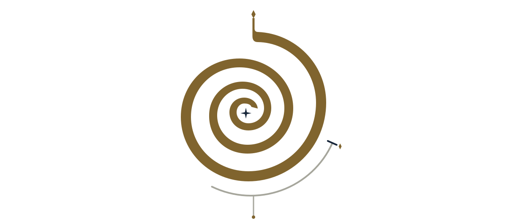
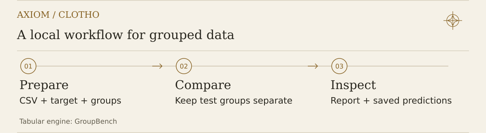

<p align="right"><strong>English</strong> · <a href="README.zh-TW.md">繁體中文</a></p>

<h1 id="axiom-clotho" align="center">Axiom Clotho</h1>

<picture>
  <source media="(prefers-color-scheme: dark) and (max-width: 600px)" srcset="docs/assets/clotho-ritual-hero-dark-mobile.svg">
  <source media="(max-width: 600px)" srcset="docs/assets/clotho-ritual-hero-light-mobile.svg">
  <source media="(prefers-color-scheme: dark)" srcset="docs/assets/clotho-ritual-hero-dark.svg">
  
</picture>

Prepare device measurements, compare models without mixing declared batches, and predict new samples locally. Clotho is the **Moirai** machine-learning workbench: today, fixed-condition device regression and grouped tabular learning; broader domain modules are future work.

[**I / Begin**](#begin) · [**II / The thread**](#thread) · [**III / Read the evidence**](#evidence) · [**IV / Horizon**](#horizon)

> **[Download 0.3.0b4 beta](https://github.com/xinhi6716/axiom-clotho/releases/tag/v0.3.0b4)** · local computation · explicit user-supplied endpoints. This release adds blank-input setup for your measurements alongside the existing FET, RRAM and tabular workflows. [Changes and verification scope](docs/RELEASE_NOTES_0.3.0b4.md).

<a id="begin"></a>
<a id="get-the-reviewed-beta-core"></a>

<h2 id="i--begin" align="center">I / Begin</h2>

Choose the route that matches your data—not a different product.

| You have… | Start here |
| --- | --- |
| RRAM I–V measurements, training endpoints and declared device groups | The **four-stage measurement workflow** below. |
| Canonical FET transfer curves, composite device IDs and separate endpoints | The **[FET four-stage example](examples/fet-device-regression/README.md)**. |
| A numeric/categorical table for grouped regression or explicit binary classification | The existing **[tabular calculator](#tabular-start)**, via `clotho tabular`, `mlcalc` or `groupbench`. |
| Saved predictions and later observed outcomes | **`clotho score`** for a complete Clotho cohort; other saved analyses remain in the tabular calculator. |

<details>
<summary>FET transfer data · scope and rollback</summary>

**FET transfer data?** Start with the [FET device-regression guide](docs/FET_DEVICE_REGRESSION.md): one declared acquisition per `(lot, wafer, device)`, two explicit measurement descriptors and the same grouped ML core. Frozen b3 includes FET but not `init`; b2 lacks FET. All older releases remain unchanged for rollback.

</details>

<details>
<summary>Start with your own files · included in b4</summary>

**Starting with your own measurement files?** Available in 0.3.0b4,
`clotho init --workflow rram --out my-measurements` (or `--workflow fet`) creates
header-only CSVs, an intentionally unfinished configuration and a local checklist.
No invented rows, inferred units or accepted scientific declarations.
**Not available in the frozen b3 wheel or tag.** [Blank-input setup guide](docs/WORKFLOW_INIT.md).

</details>

<details>
<summary>Package identity and compatibility</summary>

The repository is now **`axiom-clotho`**. The distribution deliberately remains **`ml-super-calculator`**; existing imports and CLI names keep one owner. Do not co-install a second overlapping distribution. [Compatibility and migration](docs/CLOTHO_BETA_MIGRATION.md).

</details>

### Install the beta

Download the wheel, matching source archive and `SHA256SUMS.txt` from the **[0.3.0b4 release](https://github.com/xinhi6716/axiom-clotho/releases/tag/v0.3.0b4)**. Verify the checksums, then install the wheel in a separate compatible environment:

```bash
python -m pip install --no-index --no-deps ./ml_super_calculator-0.3.0b4-py3-none-any.whl
clotho --version
```

Requires Python ≥3.10 and existing `numpy>=1.24,<3`, `pandas>=2,<3`, `scikit-learn>=1.4,<2`, and `threadpoolctl>=3,<4`. Declared bounds are not a fully tested version matrix. This command does not fetch missing dependencies. The [installation guide](docs/RELEASE_NOTES_0.3.0b4.md#installation-and-reproducible-example) explains that boundary. Extract the matching source archive for the fixture files used in **The thread** below; they are not downloaded by the CLI. Prefer a source checkout? Use the alternative below.

<details>
<summary><strong>Install the reviewed beta core from source</strong> · new checkout and virtual environment</summary>

The fixed `v0.3.0b4` tag identifies the beta source with both RRAM v1 and FET v2 workflows plus blank-input `init`. Check the release receipt and matching wheel/source assets before using this source-install route.

```bash
git clone https://github.com/xinhi6716/axiom-clotho.git clotho-source
cd clotho-source
git checkout --detach v0.3.0b4
python -m venv .venv
# POSIX activation; on Windows use .venv\Scripts\activate instead.
. .venv/bin/activate
python -m pip install -e .
clotho --version
```


The b4 wheel and tagged source checkout above both report `0.3.0b4`. See the [b4 release guide](docs/RELEASE_NOTES_0.3.0b4.md). Installation may fetch build/runtime dependencies from your configured index. Offline use requires an already-provisioned compatible environment. No PyPI publication is implied. For wheel installation and checksum verification, see the [installation guide](docs/RELEASE_NOTES_0.3.0b4.md#installation-and-reproducible-example).

</details>

Python 3.10+ is declared; verification used Linux/Python 3.12.14 and existing dependencies. Computation stays local: no account, hosted ML API, model-weight download or telemetry.

<a id="thread"></a>
<a id="what-this-beta-completes"></a>
<a id="four-stage-quickstart"></a>

<h2 id="ii--the-thread" align="center">II / The thread</h2>

**Prepare → Plan → Run → Score.** Each stage has one responsibility; later outcomes enter only at scoring.

<picture>
  <source media="(prefers-color-scheme: dark) and (max-width: 600px)" srcset="docs/assets/clotho-ritual-process-dark-mobile.svg">
  <source media="(max-width: 600px)" srcset="docs/assets/clotho-ritual-process-light-mobile.svg">
  <source media="(prefers-color-scheme: dark)" srcset="docs/assets/clotho-ritual-process-dark.svg">
  
</picture>

| Step | What happens | What does not happen |
| --- | --- | --- |
| **Prepare** | Extract supported resistance features; join exact device IDs to **training-only targets**; validate declared groups. | No inferred labels, units or physical grouping. |
| **Plan** | Inspect nested splits, candidates and the fit budget. | No model fitting. |
| **Run** | Compare within training groups, refit on training data and save target-free future predictions. | No prediction-cohort outcome input. |
| **Score** | Join later outcomes to saved predictions; save row/equal-group evaluation. | **No new fits.** |

<details>
<summary><strong>Run the complete four-stage example</strong> · all supplied values are invented</summary>

From the checkout root, or the extracted source archive matching your installation, choose fresh output directories outside the inputs. The fixture CSVs come from the source archive; the commands do not download them.

```bash
clotho prepare \
  --input-dir examples/measurement-regression/fixtures/raw \
  --partitions examples/measurement-regression/fixtures/partitions.csv \
  --training-targets examples/measurement-regression/fixtures/training_targets.csv \
  --config examples/measurement-regression/fixtures/config.json \
  --output-dir clotho-prepared

clotho plan --prepared clotho-prepared
clotho run --prepared clotho-prepared --output-dir clotho-run

# Only this separate scoring step accepts the prediction cohort's later outcomes.
clotho score --run-dir clotho-run \
  --outcomes examples/measurement-regression/fixtures/later_outcomes.csv \
  --output-dir clotho-evaluation
```

Expected structure: **18 devices → 12 training + 6 prediction**; four training batches and two disjoint prediction batches; **40 planned fits**, then six-device scoring with **zero new fits**. These counts check software behavior, not real-device accuracy. [Complete reproduction](examples/measurement-regression/README.md).

</details>

For your measurements, replace the invented inputs with your own [raw files, partitions, training targets and explicit configuration](docs/CLOTHO_CSV_BETA.md). This RRAM route is **one row per device at a fixed declared condition**, batch/wafer/device grouping, and selected resistance predictors. Scientific endpoint meaning and feature timing remain your responsibility.

<a id="evidence"></a>

<h2 id="iii--read-the-evidence" align="center">III / Read the evidence</h2>

The run is useful only when its evidence is readable and kept together.

| Open | Read it for |
| --- | --- |
| `clotho-run/report.html` | The workflow summary and links to the nested grouped comparison. |
| `clotho-run/prediction_rows.csv` | Exact device-keyed future predictions—not a fresh test score. |
| `clotho-evaluation/report.html` | Separate descriptive evaluation once later observations are supplied. |
| `COMPLETE.json` in each bundle | Completion and file-byte checksums—not authenticity or scientific validity. |

Reports are standalone local files. **Review private IDs, targets and predictions before sharing.** The calculator's bilingual controls change report copy, not numbers; the new measurement summary pages remain English in this beta.

<a id="tabular-start"></a>

**Tabular calculator:** open the first panel to run a demo or supply your CSV. Results, examples and limits have their own panels below.

<details>
<summary><strong>1 / Start with a table</strong> · demo, input columns, plan and predict</summary>

## Try the demo

For the existing tabular calculator's wholly invented 288-row / 24-batch demo:

```bash
clotho tabular demo --out runs/demo
# Unchanged equivalent: mlcalc demo --out runs/demo
```

Open `runs/demo/report.html`. The original instructional figure remains below; it describes the calculator's table workflow, not the new measurement contract.

<picture>
  <source media="(max-width: 600px)" srcset="docs/assets/readme-workflow.mobile.svg">
  
</picture>

The bundled `clotho demo` is a **different, older fixed semiconductor rehearsal**. It no longer needs a second toolbox checkout, but is not the caller-CSV route above. [Single-distribution bridge and pinned components](docs/INTEGRATED_MEASUREMENT_WORKFLOW.md).

## Bring your data

Start with a CSV containing three things:

| Column | What belongs here |
| --- | --- |
| Target | A finite numeric outcome, such as a measured property. |
| Group | The batch, specimen, wafer or source experiment that must stay on one side of the split. |
| Features | Numeric or categorical inputs available **before** the outcome is measured. Missing feature values are supported. |

```bash
mlcalc run measurements.csv \
  --target mobility \
  --group wafer_batch \
  --features temperature_c,pressure_mpa,duration_min,material_family \
  --out runs/mobility
```

The target and group are excluded from predictors. Use `--features` or `--features-file` to keep IDs, post-outcome measurements and notes out too. Without an allowlist, **every other column becomes a feature**; the calculator cannot decide which inputs are scientifically valid.

Export UTF-8 CSV with commas between fields and a dot for decimal numbers (such as `1.5`). If your export uses semicolon delimiters or decimal commas, change those export settings first. A feature value such as `"1,5"` is categorical text, not automatically converted to `1.5`. Before fitting, use the `plan` commands below and check the `dtype` entries in `feature_schema` for features you intend to be numeric.

Prefer a ready-made input? Use the [synthetic training CSV](examples/synthetic_materials.csv) and [new process settings](examples/new_process_settings.csv). Their values are invented.

### Plan first, then fit

```bash
mlcalc plan run examples/synthetic_materials.csv --target response --group batch
mlcalc plan predict examples/synthetic_materials.csv examples/new_process_settings.csv --target response --group batch
```

Plans validate inputs and print split sizes, candidate settings and intended fit counts as JSON to stdout. They do not fit models or write results. Defaults require **105 evaluation fits** or **21 prediction fits** if all fits succeed. These counts are not a runtime estimate or a hard compute budget. [Planning details](docs/USAGE_REFERENCE.md#preview-the-work-before-fitting)

### Predict new rows after evaluation

Supply a second CSV with **exactly the selected feature columns**, without target or group columns:

```bash
mlcalc predict measurements.csv new_process_settings.csv \
  --target mobility \
  --group wafer_batch \
  --features temperature_c,pressure_mpa,duration_min,material_family \
  --out runs/new-predictions
```

Prediction performs grouped inner selection on all labeled rows and refits locally. It writes predictions in target units, not a new test-performance estimate. No executable model is loaded or saved; the CLI refits each time. Simple input-support flags can highlight unseen values, but they are **not uncertainty intervals or an out-of-distribution test**. [Prediction and input-support details](docs/USAGE_REFERENCE.md#predict-new-rows)

If a prediction CSV is rejected, follow the [no-fit column-repair steps](docs/USAGE_REFERENCE.md#repair-a-prediction-column-mismatch). Current source identifies missing and unexpected feature names; it does not silently alter your data.

</details>

<details>
<summary><strong>2 / Read and verify results</strong></summary>

## Read the results

| File | Start here when you want to… |
| --- | --- |
| `report.html` | Compare models and inspect the worst-performing groups. |
| `summary.json` | Read pooled, per-group and per-fold metrics. |
| `predictions.csv` | Inspect observed targets, predictions and fold assignments row by row. |
| `manifest.json` | Check splits, candidate selections, versions, seeds, hashes and diagnostics. |
| `checksums.json` | Check the bytes of the four other evaluation files. |

Calculator result manifests and reports record an [observed package-source digest](docs/PACKAGE_SOURCE_IDENTITY.md), or its unavailability. It is self-reported source-byte metadata, not proof of loaded code, an authenticated build or reproducibility.

Reports explain [what the chosen split can answer](docs/PROTOCOL.md#read-the-split-scope): group-heldout is not automatically domain-heldout, and no separate random-row comparison is run. A note appears when each recorded group has one row. **View all N groups** expands the compact worst-15 view without recalculating scores. Native **English / 繁體中文** controls change calculator report copy only, not saved values, diagnostics or CLI language. These calculator report features were already included in legacy a4; the new measurement workflow's summary pages remain English in this beta.

Full tables are not truncated to fit: binary output rejects a payload over 64 MiB; `verify` has the same per-file limit.

Regression compares **Dummy mean, Ridge and Extra Trees** with the same folds and preprocessing. Hyperparameters are selected inside each outer training partition. The `selected` entry evaluates the selection procedure, rather than choosing a winner after inspecting the outer test scores. Families do **not** receive equal compute budgets.

Group MAE gives each group equal weight; row MAE and RMSE pool observations. Constant-target or one-row R² is `null`. Do not repeatedly tune against the outer leaderboard and then present those same scores as unbiased evidence. [Full evaluation protocol](docs/PROTOCOL.md)

```bash
mlcalc verify runs/demo
```

`verify` checks saved bytes against checksums without fitting or loading models. It requires POSIX no-follow file access and rejects unsupported platforms. A pass proves neither authenticity nor scientific correctness. The separate `validate-prediction-bundle` command checks supported prediction manifest/CSV relationships. [Verification limits](docs/USAGE_REFERENCE.md#verify-an-existing-bundle-offline) · [Prediction bundle contract](docs/PREDICTION_BUNDLE_SCHEMA.md)

**Before sharing:** reports contain group IDs, target values, predictions and feature names. Keep private data and run directories out of public commits. CSV values are not spreadsheet-formula sanitized; review files before opening them in spreadsheet software or uploading them.

</details>

<details>
<summary><strong>3 / Explore examples and binary classification</strong></summary>

## Examples

| Try this | What it demonstrates |
| --- | --- |
| [Python API](examples/python_api.py) | `benchmark`, `fit_predict` and local output files. A sklearn-like estimator is also documented in the [API reference](docs/USAGE_REFERENCE.md#python-api). |
| [Environment-heldout comparison](examples/environment-heldout-comparison/README.md) | Five fixed pipelines, two prespecified feature sets and a training-label-shuffle diagnostic. Predictive stress testing, not causal inference. |
| [Semiconductor walkthrough](examples/semiconductor-heldout-walkthrough/README.md) | Invented I–V measurements through a trusted local Toolbox checkout to device features, lot holdout, training-only fits, target-free prediction and separate scoring. |
| [Causal-design rehearsal](examples/causal-design-rehearsal/README.md) | Invented equations and paired intervention oracles to rehearse adjustment choices. Not a calibrated device model or real-data causal estimator. |
| [Saved budget comparison](docs/SAVED_BUDGET_COMPARISON.md) | A descriptive two-method × two-budget comparison, including adverse cases. No retraining or provenance verification. |
| [Saved interval evaluation](docs/SAVED_INTERVAL_EVALUATION.md) | Coverage, width and interval score from already saved bounds. Does not generate or calibrate intervals. |

### Binary pass/fail, explicitly selected

```bash
mlcalc binary plan run examples/synthetic_binary_process.csv --target fail --group lot
mlcalc binary run examples/synthetic_binary_process.csv --target fail --group lot --out runs/binary
mlcalc binary predict examples/synthetic_binary_process.csv examples/new_binary_process.csv --target fail --group lot --out runs/binary-new
```

This prerelease workflow expects numeric 0/1 labels and selects among prior Dummy, regularized Logistic and bounded Extra Trees using group-balanced Brier. Both labels must appear in every training partition; single-class held-out groups are retained. The threshold is fixed at p1 ≥ 0.5, not optimized for manufacturing decisions. Binary output directories must be fresh. Default regression commands stay regression even for 0/1 targets. [Binary protocol and limits](docs/BINARY_PROTOCOL.md)

**Binary calculator report UI:** English / 繁體中文 switching, section navigation and keyboard-scrollable tables. Scores and saved data are unchanged by the switch. [Reading guide and version scope](docs/BINARY_PROTOCOL.md#read-the-offline-evaluation-report)

</details>

<details>
<summary><strong>4 / Check scientific and resource limits</strong></summary>

## Know the boundaries

- **Choose groups with care.** Disjoint batch labels do not isolate unrecorded dependencies or both factors in a crossed `batch × specimen` label. Multi-axis and temporal holdouts are not implemented.
- **Small groups can change the ranking.** Fold variation is not a confidence interval; one seed is not a robustness study. Validate independently before consequential use.
- **Keep tabular-calculator inputs bounded and local.** At most 20,000 rows and 100 features; CSVs must be regular local UTF-8 files, at most 64 MiB each. Missing targets, malformed records, NUL characters and invalid splits fail rather than being silently repaired. These guards are not hard memory or time limits.
- **Check categorical markers.** The compatibility default `legacy-v1` can merge a literal `__GROUPBENCH_MISSING__` string with missing values. Choose `distinct-v2` for collision-free internal keys. [Encoding contract](docs/CATEGORICAL_ENCODING.md)
- **Separate predictions from scientific claims.** No calibrated uncertainty, causal inference, scientific-unit validation, extrapolation guarantee, foundation-model training or production monitoring is included. Synthetic fixtures are not validated materials simulators.

The measurement route separately enforces its [8 MiB/file, 10,000-row and strict endpoint/declaration contracts](docs/CLOTHO_CSV_BETA.md). It is regression-only; not every toolbox format or analysis is integrated. Cross-browser, mobile and assistive-technology presentation of the new summary pages has not yet been verified.

The [complete usage reference](docs/USAGE_REFERENCE.md) retains the detailed input, schema, arithmetic, resource, output and compatibility contracts. Documentation examples do not establish real-device accuracy. A valid feature schema is not proof against leakage.


</details>

<a id="horizon"></a>

<h2 id="iv--horizon" align="center">IV / Horizon</h2>

**First depth, then breadth.** The direction is a general ML builder: composable domain modules around explicit inputs, controlled fitting and inspectable results. The first deep domain is semiconductor/materials work. Other domains and broader construction/automation are **future work**, not delivered capability.

Today is deliberately narrower: fixed-condition device-level measurement regression, plus the existing grouped tabular calculator. Not every toolbox format is integrated. This is not a foundation model, full AutoML system, causal identification engine or calibrated-uncertainty service. Declared groups cannot reveal unrecorded dependencies, and invented examples do not establish physical accuracy.

Report styling does not change model selection, splits or metrics. Cross-browser and mobile presentation checks are still pending.

[Input contract](docs/CLOTHO_CSV_BETA.md) · [Evaluation protocol](docs/PROTOCOL.md) · [Beta release guide](docs/RELEASE_NOTES_0.3.0b4.md) · [Roadmap](ROADMAP.md) · [Security](SECURITY.md)

<details>
<summary><strong>Legacy releases and rollback</strong> · frozen b2, b1, a4, a3 and earlier assets</summary>

## Legacy releases

<a id="choose-the-version-you-mean"></a>

### Legacy b2 — RRAM and tabular beta, without FET

[v0.3.0b2](https://github.com/xinhi6716/axiom-clotho/releases/tag/v0.3.0b2) retains the portable bundle-path fix but does not contain the FET v2 adapter. Its tag, wheel, source archive and checksums are unchanged. Use its own [historical installation guide](docs/RELEASE_NOTES_0.3.0b2.md) for a separate rollback environment.

### Legacy b1 — frozen and affected by the inventory-path bug

[v0.3.0b1](https://github.com/xinhi6716/axiom-clotho/releases/tag/v0.3.0b1)
is pinned to `aec0c6a56730df8159ecf4922c2e1215d467b3f5`. It does **not** include
the portable measurement-bundle inventory fix. Use b4 for a new installation;
these separate legacy routes are retained only to reproduce the frozen b1 version.
Its original assets, tag and checksums remain unchanged. [Historical b1 guide](docs/RELEASE_NOTES_0.3.0b1.md).

With compatible dependencies already provisioned, verify the original b1 wheel's
own release checksum before installing it in a separate environment:

```bash
python -m pip install --no-index --no-deps ./ml_super_calculator-0.3.0b1-py3-none-any.whl
clotho --version
```

For the exact historical source instead, use a fresh checkout and environment:

```bash
git clone https://github.com/xinhi6716/axiom-clotho.git clotho-b1-source
cd clotho-b1-source
git checkout --detach aec0c6a56730df8159ecf4922c2e1215d467b3f5
python -m venv .venv
# POSIX activation; on Windows use .venv\Scripts\activate instead.
. .venv/bin/activate
python -m pip install -e .
clotho --version
```

Both legacy routes report `0.3.0b1`, not b4. Source installation may fetch build
or runtime dependencies; no such download is performed by the calculator.


The verified **legacy calculator prerelease is [v0.2.0a4](https://github.com/xinhi6716/axiom-clotho/releases/tag/v0.2.0a4)**, from source [`f838ab0`](https://github.com/xinhi6716/axiom-clotho/tree/f838ab032b06d3f85a6b56dee2f940342a32aded). It includes the bilingual calculator reports, all-groups view, source-byte metadata and saved-interval CLI, **not** the new Clotho CSV commands. Its wheel, source archive and checksums remain unchanged.

- [a4 assets and installation receipt](https://github.com/xinhi6716/axiom-clotho/releases/tag/v0.2.0a4): verify that release's `SHA256SUMS.txt`, and use a separate environment for rollback.
- [a3](https://github.com/xinhi6716/axiom-clotho/releases/tag/v0.2.0a3) and its [historical notes](docs/RELEASE_NOTES_0.2.0a3.md), [a2](https://github.com/xinhi6716/axiom-clotho/releases/tag/v0.2.0a2), and [a1](https://github.com/xinhi6716/axiom-clotho/releases/tag/v0.2.0a1) remain historical snapshots, not the current beta quickstart.

The Clotho product name does not rename installed Python packages or rewrite these frozen releases. [Migration guidance](docs/CLOTHO_BETA_MIGRATION.md).


</details>

<details>
<summary><strong>Development, licensing and detailed reference index</strong></summary>

## Develop and contribute

```bash
python -m unittest discover -s tests -v
python examples/python_api.py
```

The suite uses the standard-library `unittest`. For an uninstalled checkout, prefix either command with `PYTHONPATH=src`. Read the [contribution guide](CONTRIBUTING.md), [roadmap](ROADMAP.md) and [security notes](SECURITY.md).

TabPFN inspired the approachable `fit`/`predict` interface and packaging, not the modeling implementation. This repository includes no TabPFN code, weights, downloads or API client and makes no equivalent-capability claim. [Reference and licensing note](docs/REFERENCES.md)

[MIT](LICENSE) covers original project code and the synthetic fixture generator. Dependencies retain their own licenses. The roadmap describes intended work, not features already delivered.

<details>
<summary>Looking for a section from the previous README?</summary>

The detailed sections now live in the usage reference. Existing section anchors are retained below.

<a id="run-the-demo"></a>

- [Run the demo](docs/USAGE_REFERENCE.md#run-the-demo)

<a id="distinguish-missing-values-from-literal-marker-strings"></a>

- [Distinguish missing values from literal marker strings](docs/USAGE_REFERENCE.md#distinguish-missing-values-from-literal-marker-strings)

<a id="source-companion-fixed-environment-feature-comparison"></a>

- [Source companion: fixed environment feature comparison](docs/USAGE_REFERENCE.md#source-companion-fixed-environment-feature-comparison)

<a id="runnable-semiconductor-integration"></a>

- [Runnable semiconductor integration](docs/USAGE_REFERENCE.md#runnable-semiconductor-integration)

<a id="simulation-only-causal-design-rehearsal"></a>

- [Simulation-only causal-design rehearsal](docs/USAGE_REFERENCE.md#simulation-only-causal-design-rehearsal)

<a id="explicit-binary-passfail-workflow-unreleased"></a>

- [Explicit binary pass/fail workflow (prerelease)](docs/USAGE_REFERENCE.md#explicit-binary-passfail-workflow-unreleased)

<a id="use-your-own-regression-data"></a>

- [Use your own regression data](docs/USAGE_REFERENCE.md#use-your-own-regression-data)

<a id="preview-the-work-before-fitting"></a>

- [Preview the work before fitting](docs/USAGE_REFERENCE.md#preview-the-work-before-fitting)

<a id="predict-new-rows"></a>

- [Predict new rows](docs/USAGE_REFERENCE.md#predict-new-rows)

<a id="check-whether-new-inputs-were-observed-in-training"></a>

- [Check whether new inputs were observed in training](docs/USAGE_REFERENCE.md#check-whether-new-inputs-were-observed-in-training)

<a id="reuse-a-declared-feature-schema"></a>

- [Reuse a declared feature schema](docs/USAGE_REFERENCE.md#reuse-a-declared-feature-schema)

<a id="python-api"></a>

- [Python API](docs/USAGE_REFERENCE.md#python-api)

<a id="how-the-evaluation-is-split-and-scored"></a>

- [How the evaluation is split and scored](docs/USAGE_REFERENCE.md#how-the-evaluation-is-split-and-scored)

<a id="baselines-and-resource-budget"></a>

- [Baselines and resource budget](docs/USAGE_REFERENCE.md#baselines-and-resource-budget)

<a id="outputs"></a>

- [Outputs](docs/USAGE_REFERENCE.md#outputs)

<a id="verify-an-existing-bundle-offline"></a>

- [Verify an existing bundle offline](docs/USAGE_REFERENCE.md#verify-an-existing-bundle-offline)

<a id="limits-to-understand-before-trusting-a-result"></a>

- [Limits to understand before trusting a result](docs/USAGE_REFERENCE.md#limits-to-understand-before-trusting-a-result)

<a id="design-inspiration-not-copied-modeling"></a>

- [Design inspiration, not copied modeling](docs/USAGE_REFERENCE.md#design-inspiration-not-copied-modeling)

<a id="develop"></a>

- [Develop](docs/USAGE_REFERENCE.md#develop)

<a id="compare-saved-validation-budgets-locally"></a>

- [Compare saved validation budgets locally](docs/USAGE_REFERENCE.md#compare-saved-validation-budgets-locally)

<a id="optional-saved-prediction-consistency"></a>

- [Optional saved prediction consistency](docs/USAGE_REFERENCE.md#optional-saved-prediction-consistency)

</details>

</details>

[Original editorial artwork and font notices](docs/assets/CLOTHO_EDITORIAL_NOTICES.md).
