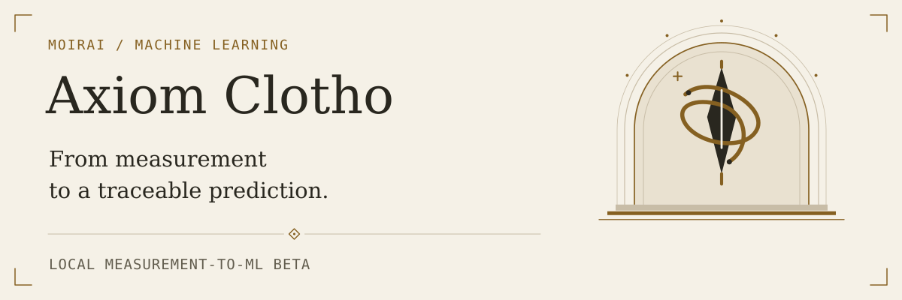
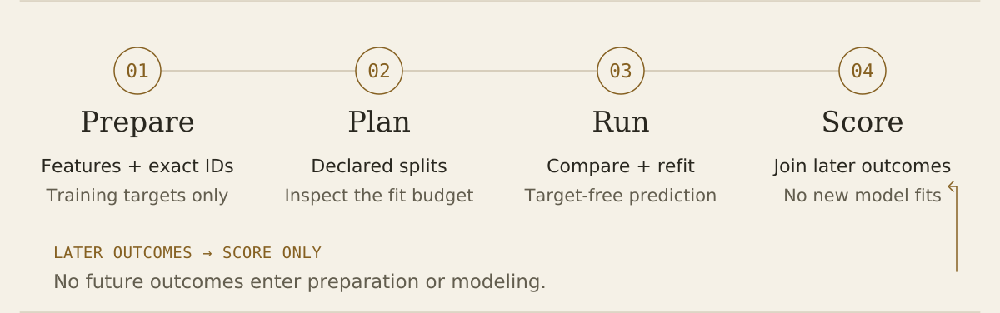
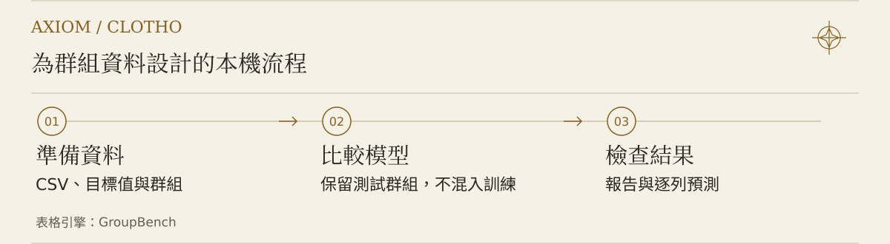

<p align="right"><a href="README.md">English</a> · <strong>繁體中文</strong></p>

# Axiom Clotho

<picture>
  <source media="(prefers-color-scheme: dark) and (max-width: 600px)" srcset="docs/assets/clotho-hero-dark-mobile.svg">
  <source media="(max-width: 600px)" srcset="docs/assets/clotho-hero-light-mobile.svg">
  <source media="(prefers-color-scheme: dark)" srcset="docs/assets/clotho-hero-dark.svg">
  
</picture>

**從量測走向模型。**

整理裝置量測、不混用宣告批次地比較模型，再於本機預測新樣本。Clotho 是 **Moirai** 的機器學習工作台；目前提供固定條件的裝置迴歸與群組表格學習，更廣泛的領域模組仍是未來工作。

[**I / 開始**](#begin) · [**II / 絲線**](#thread) · [**III / 閱讀證據**](#evidence) · [**IV / 遠景**](#horizon)

> **[已發布 beta：0.3.0b2](https://github.com/xinhi6716/axiom-clotho/releases/tag/v0.3.0b2)** · 本機運算 · 使用者明確提供目標。下方安裝步驟使用這份固定版本，已包含量測封包清單的跨平台路徑修正。[變更與驗證範圍](docs/RELEASE_NOTES_0.3.0b2.md)。凍結的 b1 保留在舊版章節。

> **`main` 的內容：**[FET 裝置迴歸路線](docs/FET_DEVICE_REGRESSION.md)已整合進原始碼，但不包含在 `v0.3.0b2` tag 或已發布的 b2 資產中。套件版本目前仍顯示 `0.3.0b2`；這條尚未發行的路線請依連結中的指南操作。

<picture><source media="(prefers-color-scheme: dark)" srcset="docs/assets/threshold-1-dark.svg"></picture>

<a id="begin"></a>
<a id="取得已審核的-beta-核心"></a>

## I / 開始

依資料選擇路線，不必換成另一個產品。

| 你有什麼 | 從哪裡開始 |
| --- | --- |
| 支援的 I–V 量測、訓練目標與明確裝置群組 | 下方的**四階段量測流程**。 |
| 用於群組迴歸或明確二元分類的數值／類別表格 | 既有[表格計算器](#tabular-start)：`clotho tabular`、`mlcalc` 或 `groupbench`。 |
| 已存預測與後來觀察到的結果 | 完整 Clotho 群體用 **`clotho score`**；其他保存資料分析仍由表格計算器提供。 |

倉庫已更名為 **`axiom-clotho`**。發行套件刻意保留 **`ml-super-calculator`**，讓既有匯入與 CLI 名稱維持單一擁有者。不要同時安裝另一個擁有重疊檔案的套件。[相容性與遷移](docs/CLOTHO_BETA_MIGRATION.md)。

### 安裝 beta

從 **[0.3.0b2 發布頁](https://github.com/xinhi6716/axiom-clotho/releases/tag/v0.3.0b2)** 下載 wheel、相符的原始碼封存檔與 `SHA256SUMS.txt`。核對校驗碼，再於獨立且相容的環境安裝：

```bash
python -m pip install --no-index --no-deps ./ml_super_calculator-0.3.0b2-py3-none-any.whl
clotho --version
```

需 Python ≥3.10，以及既有的 `numpy>=1.24,<3`、`pandas>=2,<3`、`scikit-learn>=1.4,<2`、`threadpoolctl>=3,<4`。宣告範圍不代表每個版本組合都已測試。這個指令不會下載缺少的相依套件；詳見[安裝指南](docs/RELEASE_NOTES_0.3.0b2.md#installation-and-reproducible-example)。解壓相符的原始碼封存檔，才能取得下方「絲線」範例需要的資料；CLI 不會自行下載。若偏好原始碼 checkout，可使用下方替代路線。

<details>
<summary><strong>從原始碼安裝已審核的 beta 核心</strong> · 全新 checkout 與虛擬環境</summary>

固定的 `v0.3.0b2` tag 對應已發布的 beta 原始碼，包含量測封包清單的跨平台路徑修正。使用此原始碼安裝路線前，請先核對發布收據與相符的 wheel／原始碼資產。

```bash
git clone https://github.com/xinhi6716/axiom-clotho.git clotho-source
cd clotho-source
git checkout --detach v0.3.0b2
python -m venv .venv
# POSIX 啟用；Windows 改用 .venv\Scripts\activate。
. .venv/bin/activate
python -m pip install -e .
clotho --version
```


上方 b2 wheel 與固定 tag 的原始碼 checkout 都回報 `0.3.0b2`。詳見 [b2 發行指南](docs/RELEASE_NOTES_0.3.0b2.md)。安裝可能從設定索引取得建置／執行相依套件；離線使用需事先備妥相容環境。這不是 PyPI 發布聲明。wheel 安裝與校驗碼核對方式請見[安裝指南](docs/RELEASE_NOTES_0.3.0b2.md#installation-and-reproducible-example)。

</details>

宣告 Python 3.10+；驗證使用 Linux／Python 3.12.14 與既有相依套件。運算留在本機，不需帳號、託管 ML API、模型權重下載或遙測。

<picture><source media="(prefers-color-scheme: dark)" srcset="docs/assets/threshold-2-dark.svg"></picture>

<a id="thread"></a>
<a id="這個-beta-完成什麼"></a>
<a id="四階段快速開始"></a>

## II / 絲線

**Prepare → Plan → Run → Score。** 每個階段只有一項職責；後來的結果只在評分時進入。

<picture>
  <source media="(prefers-color-scheme: dark) and (max-width: 600px)" srcset="docs/assets/clotho-process-dark-mobile.svg">
  <source media="(max-width: 600px)" srcset="docs/assets/clotho-process-light-mobile.svg">
  <source media="(prefers-color-scheme: dark)" srcset="docs/assets/clotho-process-dark.svg">
  
</picture>

| 步驟 | 做什麼 | 不做什麼 |
| --- | --- | --- |
| **Prepare** | 萃取支援的電阻特徵；以精確裝置 ID 連接**訓練專用目標**；驗證宣告群組。 | 不推測標籤、單位或物理分組。 |
| **Plan** | 檢查巢狀分割、候選模型與擬合預算。 | 不擬合模型。 |
| **Run** | 在訓練群組內比較、用訓練資料重新擬合、保存無未來標籤的預測。 | 不接受預測群體結果輸入。 |
| **Score** | 連接後來的結果與已存預測，保存逐列與群組等權評估。 | **不新增擬合。** |

<details>
<summary><strong>執行完整四階段範例</strong> · 所有提供數值皆為虛構</summary>

從 checkout 根目錄或與安裝版本相符的解壓原始碼目錄執行。輸出目錄必須全新且位於輸入之外。範例 CSV 由原始碼封存檔提供，指令不會下載它們。

```bash
clotho prepare \
  --input-dir examples/measurement-regression/fixtures/raw \
  --partitions examples/measurement-regression/fixtures/partitions.csv \
  --training-targets examples/measurement-regression/fixtures/training_targets.csv \
  --config examples/measurement-regression/fixtures/config.json \
  --output-dir clotho-prepared

clotho plan --prepared clotho-prepared
clotho run --prepared clotho-prepared --output-dir clotho-run

# 只有這個獨立評分步驟接受預測群體後來的結果。
clotho score --run-dir clotho-run \
  --outcomes examples/measurement-regression/fixtures/later_outcomes.csv \
  --output-dir clotho-evaluation
```

預期結構：**18 裝置 → 12 訓練 + 6 預測**；四個訓練批次與兩個互斥預測批次；**計畫擬合 40 次**，再對六個裝置評分，**新增擬合 0 次**。這些數字檢查軟體行為，不代表真實裝置準確度。[完整重現範例](examples/measurement-regression/README.md)。

</details>

換用自己的量測時，請提供[原始檔、分區、訓練目標及明確設定](docs/CLOTHO_CSV_BETA.md)。這條 b2 路線限於**固定宣告條件下每裝置一列**、batch／wafer／device 分組與選定電阻特徵。科學目標意義與特徵取得時序仍由你負責。

<picture><source media="(prefers-color-scheme: dark)" srcset="docs/assets/threshold-3-dark.svg"></picture>

<a id="evidence"></a>

## III / 閱讀證據

證據可讀、保持完整，這次執行才有用。

| 開啟 | 用來閱讀 |
| --- | --- |
| `clotho-run/report.html` | 流程摘要與巢狀群組比較的連結。 |
| `clotho-run/prediction_rows.csv` | 依精確裝置 ID 保存的未來預測，不是新的測試分數。 |
| `clotho-evaluation/report.html` | 提供後來觀測後，獨立保存的描述性評估。 |
| 每份輸出的 `COMPLETE.json` | 完成狀態與檔案位元組校驗，不是真實性或科學有效性認證。 |

報告是獨立本機檔案。**分享前先檢查私有 ID、目標與預測。** 計算器雙語控制只改文字，不改數字；新的量測摘要頁在此 beta 仍為英文。

<a id="tabular-start"></a>

**表格計算器：** 展開第一區試跑或放入自己的 CSV；結果、範例與限制各自分區，按需要閱讀。

<details>
<summary><strong>1 / 從表格開始</strong> · 範例、輸入欄位、計畫與預測</summary>

## 試跑範例

既有表格計算器另有全合成的 288 列／24 批範例：

```bash
clotho tabular demo --out runs/demo
# 不變的等效指令：mlcalc demo --out runs/demo
```

開啟 `runs/demo/report.html`。原本教學圖保留如下；它說明計算器的表格流程，不是新的量測輸入契約。

<picture>
  <source media="(max-width: 600px)" srcset="docs/assets/readme-workflow.zh-TW.mobile.svg">
  
</picture>

套件內的 `clotho demo` 是**另一個較早的固定半導體演練**，已不需第二份工具箱 checkout，但不是上方接受使用者 CSV 的路線。[單一套件橋接與固定來源組件](docs/INTEGRATED_MEASUREMENT_WORKFLOW.md)。

## 使用自己的資料

先準備包含三類欄位的 CSV：

| 欄位 | 應放什麼 |
| --- | --- |
| 目標 | 有限的數值結果，例如實測材料性質。 |
| 群組 | 不能跨越評估邊界的批次、試片、晶圓或來源實驗。 |
| 特徵 | 在量測結果**之前**就能取得的數值或類別輸入。允許特徵缺值。 |

```bash
mlcalc run measurements.csv \
  --target mobility \
  --group wafer_batch \
  --features temperature_c,pressure_mpa,duration_min,material_family \
  --out runs/mobility
```

目標與群組欄位會自動排除於預測特徵之外。請用 `--features` 或 `--features-file` 也排除識別碼、結果發生後的量測與備註。若未指定允許清單，**其他所有欄位都會成為特徵**；計算器無法判斷哪些輸入在科學上合理。

請匯出 UTF-8 CSV：欄位用逗號分隔，小數使用小數點（如 `1.5`）。若原匯出設定是分號分欄或小數逗號，請先調整設定。特徵中的 `"1,5"` 會當作類別文字，不會自動轉成 `1.5`。擬合前，使用下方 `plan` 指令，檢查 `feature_schema` 的 `dtype` 是否符合預期的數值欄位。

想先用現成輸入？可試 [合成訓練 CSV](examples/synthetic_materials.csv) 與 [新製程設定](examples/new_process_settings.csv)。這些數值都是虛構的。

### 先查看計畫，再開始訓練

```bash
mlcalc plan run examples/synthetic_materials.csv --target response --group batch
mlcalc plan predict examples/synthetic_materials.csv examples/new_process_settings.csv --target response --group batch
```

計畫會驗證輸入，將分割大小、候選設定與預計擬合次數，以 JSON 印至標準輸出；不擬合模型、不寫入結果。若每次擬合都成功，預設評估需 **105 次擬合**，預測需 **21 次擬合**。這不是執行時間估算，也不是硬性的運算配額。[計畫細節（英文）](docs/USAGE_REFERENCE.md#preview-the-work-before-fitting)

### 評估後，再預測新資料

第二份 CSV 必須**恰好包含選定的特徵欄位**，不含目標與群組欄位：

```bash
mlcalc predict measurements.csv new_process_settings.csv \
  --target mobility \
  --group wafer_batch \
  --features temperature_c,pressure_mpa,duration_min,material_family \
  --out runs/new-predictions
```

預測會以全部已標記資料進行群組內層選模，並在本機重新擬合。輸出使用目標原單位，不是新的測試集表現估計。不載入或儲存可執行模型，CLI 每次呼叫都會重新擬合。簡單的輸入支持範圍標記能提示未見過的值，但**不是不確定性區間，也不是分布外檢定**。[預測與輸入支持範圍細節（英文）](docs/USAGE_REFERENCE.md#predict-new-rows)

</details>

<details>
<summary><strong>2 / 閱讀與核對結果</strong></summary>

## 閱讀結果

| 檔案 | 用途 |
| --- | --- |
| `report.html` | 比較模型，檢查誤差最大的群組。 |
| `summary.json` | 查看整體、各群組與各折的指標。 |
| `predictions.csv` | 逐列檢查真值、預測與所屬折。 |
| `manifest.json` | 核對分割、候選選擇、版本、種子、雜湊與診斷。 |
| `checksums.json` | 核對其他四份評估檔案的位元組。 |

計算器結果 manifest 與報告記錄[觀察到的套件原始碼摘要](docs/PACKAGE_SOURCE_IDENTITY.md)或無法取得狀態。這是自行記錄的原始碼位元組資訊，不認證載入的程式碼、建置或可重現性。

報告說明[所選切分可回答的問題](docs/PROTOCOL.md#read-the-split-scope)：保留群組不自動等於保留領域，也沒有另外執行隨機逐列比較。每群組一列時會提示。**查看全部 N 個群組**可展開最高誤差 15 組摘要，不重新計算分數。原生 **English / 繁體中文** 控制只改變計算器報告文字，不改動數值、診斷或 CLI 語言。這些計算器報告功能已包含於舊版 a4；新的量測流程摘要頁在此 beta 仍為英文。

完整表格不會為縮檔而截掉群組：二元輸出會拒絕超過 64 MiB 的單一檔案，`verify` 也有相同的單檔上限。

回歸流程使用相同分割與前處理，比較 **Dummy 平均值、Ridge 與 Extra Trees**。超參數只在各外折的訓練部分內選擇。`selected` 評估的是整個選模程序，不是看完外層測試分數後才挑勝者。不同模型家族**沒有取得相同運算預算**。

Group MAE 給每個群組相同權重；row MAE 與 RMSE 合併所有觀測列計算。目標為常數或只有一列時，R² 為 `null`。不要反覆依外層排行榜調參，再把同一批分數當成無偏證據。[完整評估協定（英文）](docs/PROTOCOL.md)

```bash
mlcalc verify runs/demo
```

`verify` 不擬合或載入模型，只比對保存檔案與 checksum 的位元組。它需要 POSIX 的 no-follow 檔案存取能力，不支援的平台會被拒絕。通過不代表來源真實或科學正確。另一個 `validate-prediction-bundle` 指令可檢查受支援的預測 manifest／CSV 關係。[驗證限制（英文）](docs/USAGE_REFERENCE.md#verify-an-existing-bundle-offline) · [預測封包規格（英文）](docs/PREDICTION_BUNDLE_SCHEMA.md)

**分享前先檢查：** 報告含群組識別碼、目標值、預測值與特徵名稱。不要把私人資料與執行目錄提交至公開倉庫。CSV 未針對試算表公式做清理；使用試算表軟體開啟或上傳前，請先確認內容。

</details>

<details>
<summary><strong>3 / 範例與二元分類</strong></summary>

## 範例

以下詳細範例文件目前以英文撰寫。

| 範例 | 展示內容 |
| --- | --- |
| [Python API](examples/python_api.py) | `benchmark`、`fit_predict` 與本機輸出。另有類 sklearn 估計器，見 [API 參考](docs/USAGE_REFERENCE.md#python-api)。 |
| [跨環境保留評估](examples/environment-heldout-comparison/README.md) | 五條固定流程、兩組預先指定特徵，以及訓練標籤打亂診斷。這是預測壓力測試，不是因果推論。 |
| [半導體串接範例](examples/semiconductor-heldout-walkthrough/README.md) | 虛構 I–V 量測經可信任的本機 Toolbox checkout 轉成元件特徵，再做批次保留、只用訓練資料擬合、不讀取保留元件目標值的預測，並另行計分。 |
| [因果設計演練](examples/causal-design-rehearsal/README.md) | 用虛構方程與成對介入真值演練調整變項的選擇。不是經校準的元件模型或真實資料因果估計器。 |
| [已保存的預算比較](docs/SAVED_BUDGET_COMPARISON.md) | 兩方法 × 兩預算的描述性比較，保留不利案例。不重新訓練，也不驗證來源。 |
| [已保存的區間評估](docs/SAVED_INTERVAL_EVALUATION.md) | 從已保存的上下界計算覆蓋率、寬度與區間分數。不產生或校準區間。 |

### 二元通過／失敗：須明確選用

```bash
mlcalc binary plan run examples/synthetic_binary_process.csv --target fail --group lot
mlcalc binary run examples/synthetic_binary_process.csv --target fail --group lot --out runs/binary
mlcalc binary predict examples/synthetic_binary_process.csv examples/new_binary_process.csv --target fail --group lot --out runs/binary-new
```

這條預發布流程使用數值 0/1 標籤，以群組平衡 Brier 分數，在先驗 Dummy、正則化 Logistic 與有界 Extra Trees 中選擇。每個訓練分割都須包含兩種標籤；只有單一類別的保留群組仍會保留。門檻固定為 p1 ≥ 0.5，未針對製造決策最佳化。二元流程的輸出目錄必須是新的。預設回歸指令即使收到 0/1 目標也仍做回歸。[二元流程協定與限制（英文）](docs/BINARY_PROTOCOL.md)

**二元計算器報告介面：** 支援 English / 繁體中文切換、章節導覽與可用鍵盤橫向捲動的表格。切換不會改變分數或已儲存資料。[閱讀指南與版本範圍（英文）](docs/BINARY_PROTOCOL.md#read-the-offline-evaluation-report)

</details>

<details>
<summary><strong>4 / 科學與資源限制</strong></summary>

## 使用界線

- **謹慎選擇群組。** 批次標籤互斥，不代表未記錄的相依性已隔離；`batch × specimen` 組合標籤也不會自動隔離兩個交叉因素。目前沒有多軸或時間保留評估。
- **小群組可能改變排名。** 各折差異不是信賴區間；單一種子不是穩健性研究。用於重要決策前，應另行獨立驗證。
- **表格計算器的輸入留在本機，並控制大小。** 上限為 20,000 列、100 個特徵；CSV 必須是本機一般 UTF-8 檔案，每份最多 64 MiB。缺少目標、格式不完整的列、NUL 字元或無效分割都會失敗，不會默默修補。這些防護不是硬性的記憶體或時間限制。
- **注意類別缺值標記。** 相容性預設 `legacy-v1` 可能把字串 `__GROUPBENCH_MISSING__` 與缺值合併。選用 `distinct-v2` 可使用不碰撞的內部鍵。[編碼規格（英文）](docs/CATEGORICAL_ENCODING.md)
- **把預測與科學主張分開。** 不提供經校準的不確定性、因果推論、物理單位驗證、外推保證、基礎模型訓練或正式環境監控。合成範例不是經驗證的材料模擬器。

[完整技術參考（英文）](docs/USAGE_REFERENCE.md) 保留輸入、schema、算術、資源、輸出與相容性的詳細規格。文件範例不構成真實元件的準確度證據；有效的特徵 schema 也不代表沒有資料洩漏。

新的量測路線另有 [8 MiB／檔、10,000 列及嚴格目標／宣告契約](docs/CLOTHO_CSV_BETA.md)，只支援迴歸，並非已整合全部工具箱格式或分析。新摘要頁的跨瀏覽器、行動裝置及輔助技術呈現尚未驗證。


</details>

<picture><source media="(prefers-color-scheme: dark)" srcset="docs/assets/threshold-4-dark.svg"></picture>

<a id="horizon"></a>

## IV / 遠景

**先做深，再做廣。** 方向是通用 ML 建構器：以明確輸入、可控擬合與可檢查結果為核心，組合可擴充的領域模組。第一個深耕領域是半導體／材料；其他領域、更廣的建構與自動化仍是**未來工作**，不是既有能力。

現在刻意保持較窄：固定條件的裝置量測迴歸，加上既有群組表格計算器。並非全部工具箱格式都已整合；不是基礎模型、完整 AutoML、因果識別引擎或已校準不確定性服務。宣告群組無法找出未記錄的相依性，虛構範例也不證明物理準確度。

報告外觀不改動選模、切分或指標。跨瀏覽器與行動裝置的呈現檢查仍待完成。

[輸入契約](docs/CLOTHO_CSV_BETA.md) · [評估協定](docs/PROTOCOL.md) · [Beta 發行指南](docs/RELEASE_NOTES_0.3.0b2.md) · [路線圖](ROADMAP.md) · [安全說明](SECURITY.md)

<details>
<summary><strong>舊版發行與回退</strong> · 凍結的 b1、a4、a3 與更早檔案</summary>

## 舊版發行

<a id="先選擇要使用的版本"></a>

### 舊版 b1 — 已凍結，仍受封包清單路徑問題影響

[v0.3.0b1](https://github.com/xinhi6716/axiom-clotho/releases/tag/v0.3.0b1)
固定於 `aec0c6a56730df8159ecf4922c2e1215d467b3f5`，**不含**量測封包清單的
跨平台路徑修正。新安裝請使用 b2；以下獨立舊版路線僅供重現凍結的 b1。
原有資產、tag 與校驗碼都保持不變。[歷史 b1 指南](docs/RELEASE_NOTES_0.3.0b1.md)。

若已備妥相容相依套件，先核對原始 b1 wheel 自己的發布校驗碼，再於獨立環境安裝：

```bash
python -m pip install --no-index --no-deps ./ml_super_calculator-0.3.0b1-py3-none-any.whl
clotho --version
```

若要精確的歷史原始碼，請使用全新 checkout 與環境：

```bash
git clone https://github.com/xinhi6716/axiom-clotho.git clotho-b1-source
cd clotho-b1-source
git checkout --detach aec0c6a56730df8159ecf4922c2e1215d467b3f5
python -m venv .venv
# POSIX 啟用；Windows 改用 .venv\Scripts\activate。
. .venv/bin/activate
python -m pip install -e .
clotho --version
```

兩條舊版路線都回報 `0.3.0b1`，不是 b2。原始碼安裝可能取得建置或執行相依套件；
計算器不會自行進行這類下載。


已核驗的**舊計算器預發布版為 [v0.2.0a4](https://github.com/xinhi6716/axiom-clotho/releases/tag/v0.2.0a4)**，對應 [`f838ab0` 原始碼](https://github.com/xinhi6716/axiom-clotho/tree/f838ab032b06d3f85a6b56dee2f940342a32aded)。它包含雙語計算器報告、所有群組檢視、原始碼位元組紀錄與保存區間評估 CLI，**不含**新的 Clotho CSV 指令。wheel、原始碼封存檔與校驗碼保持不變。

- [a4 檔案與安裝紀錄](https://github.com/xinhi6716/axiom-clotho/releases/tag/v0.2.0a4)：核對該版 `SHA256SUMS.txt`；回退請用獨立環境。
- [a3](https://github.com/xinhi6716/axiom-clotho/releases/tag/v0.2.0a3) 與其[歷史說明](docs/RELEASE_NOTES_0.2.0a3.md)、[a2](https://github.com/xinhi6716/axiom-clotho/releases/tag/v0.2.0a2)、[a1](https://github.com/xinhi6716/axiom-clotho/releases/tag/v0.2.0a1) 保留為歷史快照，不是目前 beta 快速開始流程。

Clotho 產品名稱不會更名已安裝的 Python 套件，也不重寫凍結版本。[遷移說明](docs/CLOTHO_BETA_MIGRATION.md)。


</details>

<details>
<summary><strong>開發、授權與完整參考索引</strong></summary>

## 開發與貢獻

```bash
python -m unittest discover -s tests -v
python examples/python_api.py
```

測試使用標準函式庫 `unittest`。若尚未安裝 checkout，請在兩個指令前加上 `PYTHONPATH=src`。另請閱讀 [貢獻指南](CONTRIBUTING.md)、[路線圖](ROADMAP.md) 與 [安全說明](SECURITY.md)，目前皆為英文。

TabPFN 提供的是易用 `fit`／`predict` 介面與套件設計的參考，不是模型實作來源。本倉庫不包含 TabPFN 程式、權重、下載流程或 API 用戶端，也不宣稱具同等能力。[參考與授權說明（英文）](docs/REFERENCES.md)

原創專案程式與合成資料產生器採 [MIT](LICENSE) 授權；相依套件保留各自授權。路線圖描述預定工作，不代表功能已經交付。

<details>
<summary>在找舊版 README 的某個段落？</summary>

詳細段落已移至 [完整技術參考（英文）](docs/USAGE_REFERENCE.md)。英文首頁保留舊段落錨點，方便沿用原本的連結。

</details>

</details>

[Original editorial artwork and font notices](docs/assets/CLOTHO_EDITORIAL_NOTICES.md).
