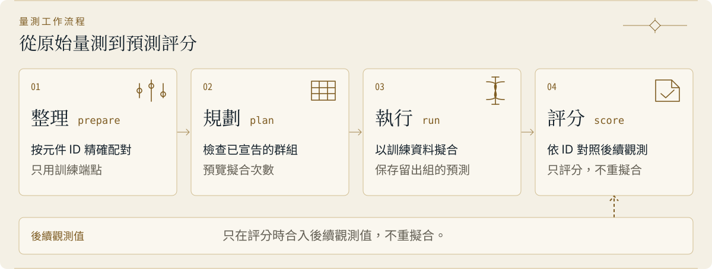

<p align="center"></p>

<h1 id="axiom-clotho" align="center"><picture><source media="(prefers-color-scheme: dark)" srcset="https://raw.githubusercontent.com/xinhi6716/xinhi6716/443d48c713f27d52656ad8ea3cb4c5bb9c7dd440/assets/brand-marks/v1/clotho-icon-dark.svg"></picture> Axiom Clotho</h1>

<p align="center"><strong>半導體資料的本機建模、分組評估與重現。</strong></p>
<p align="center"><a href="README.md">English</a> · <strong>繁體中文</strong></p>

Clotho 可將支援的 RRAM 或 FET 量測整理為元件特徵，也可直接讀取特徵 CSV。評估時讓相依的元件、晶圓或批次留在同一組；先保存預測，再合入後續觀測值。

| 手邊有什麼 | 從這裡開始 |
| --- | --- |
| 想先試跑，或已經有特徵表 | [Python 快速開始](#begin) · [分組 CSV 範例](#tabular-start) |
| 符合支援格式的原始量測 | [RRAM 與 FET 工作流程](#thread) |
| 需要不依賴 Python 的本機工具 | [`main` 的原生 Rust](#native-rust) |
| 已保存的預測或執行結果 | [讀取與驗證產物](#evidence) |

<a id="begin"></a>
<a id="get-the-reviewed-beta-core"></a>
<a id="先選擇要使用的版本"></a>

<a id="開始使用"></a>

## Python 快速開始

以 Python 3.10 以上版本建立獨立環境。**有標籤的 Python beta 與目前原始碼是兩條路徑：** [v0.3.0b7](https://github.com/xinhi6716/axiom-clotho/releases/tag/v0.3.0b7) 已凍結；`main` 包含後續的 Python 和原生 Rust 開發。

```bash
git clone --branch v0.3.0b7 https://github.com/xinhi6716/axiom-clotho.git clotho-source
cd clotho-source
python -m venv .venv
# POSIX; on Windows Command Prompt: .venv\Scripts\activate.bat
. .venv/bin/activate
python -m pip install .
clotho --version
```

<a id="try-the-demo"></a>

### 產生第一份報告

```bash
clotho tabular demo --out runs/demo
```

開啟 `runs/demo/report.html`。Demo 使用合成資料擬合模型；每次執行請指定新的輸出目錄。套件名稱為 `ml-super-calculator`，量測流程使用 `clotho` 或 `mlcalc-workflow`；分組表格使用 `mlcalc`、`groupbench` 或 `clotho tabular`。安裝相依套件可能需要網路；建模在本機進行。

**用 release wheel 安裝：** 先以同一版的 `SHA256SUMS.txt` 驗證 wheel。[安裝指南](docs/RELEASE_NOTES_0.3.0b7.md#installation-and-reproducible-example) 說明如何在已備妥相依套件的環境離線安裝。範例 CSV 在原始碼封包內，不在 wheel 裡。

<a id="tabular-start"></a>

<a id="使用自己的表格"></a>

## 評估分組 CSV

在該標籤的原始碼目錄執行：

```bash
mlcalc plan run examples/synthetic_materials.csv --target response --group batch \
  --features temperature_c,pressure_mpa,duration_min,material_family
mlcalc run examples/synthetic_materials.csv --target response --group batch \
  --features temperature_c,pressure_mpa,duration_min,material_family --out runs/grouped
```

`plan run` 會預覽切分與擬合次數，不訓練模型。`run` 會將宣告的群組分開，並只用各訓練分區擬合前處理。換成自己的 CSV 時，請替換路徑、目標欄、群組欄和特徵；排除識別碼、備註及預測當下還拿不到的欄位。

| 任務 | 指令 |
| --- | --- |
| 數值結果 | `mlcalc run`：預設比較平均值基準、Ridge 和 Extra Trees。 |
| 二元結果 | `mlcalc binary`：明確以 0/1 為目標，比較 Dummy、Logistic 和 Extra Trees。[二元工作流程](docs/BINARY_PROTOCOL.md) |
| 預測新資料 | `mlcalc predict`：在有標籤的訓練資料上選模與重擬合，再用僅有特徵的 CSV 預測。這一步不產生新的測試分數。[b7 預測指南](https://github.com/xinhi6716/axiom-clotho/blob/v0.3.0b7/docs/USAGE_REFERENCE.md#predict-new-rows) |

<a id="thread"></a>
<a id="what-this-beta-completes"></a>
<a id="four-stage-quickstart"></a>

## 從量測到預測

<picture>
  <source media="(prefers-color-scheme: dark) and (max-width: 600px)" srcset="docs/assets/clotho-workflow-zh-TW-dark-mobile.svg">
  <source media="(max-width: 600px)" srcset="docs/assets/clotho-workflow-zh-TW-light-mobile.svg">
  <source media="(prefers-color-scheme: dark)" srcset="docs/assets/clotho-workflow-zh-TW-dark.svg">
  
</picture>

| 支援的輸入 | 起點 |
| --- | --- |
| RRAM I–V 量測 | 在指定條件下彙整電阻，每個元件一列。[完整 RRAM 範例](examples/measurement-regression/README.md) |
| 符合規格的 FET 轉移曲線 | 每個批次、晶圓與元件使用一次宣告的量測，擷取判定點 VGS 及對數電流窗內斜率。[完整 FET 範例](examples/fet-device-regression/README.md) |

```bash
clotho init --workflow rram --out my-measurements
```

FET 樣板請改用 `--workflow fet`。`init` 只建立表頭、設定和檢查清單，不捏造量測值，也不猜測單位。填好後依序執行 `prepare`、`plan`、`run`。只有 `score` 會讀取預測組的後續觀測值，再與保存的預測配對，不重新擬合。[輸入設定](docs/WORKFLOW_INIT.md) · [量測評估規格](docs/INTEGRATED_MEASUREMENT_WORKFLOW.md)

<a id="native-rust"></a>

## `main` 的原生 Rust

另取一份 **`main` 原始碼**，不要在凍結的 b7 標籤執行。需 Rust 1.70 以上版本。Cargo 第一次需取得相依套件；鎖版建置與範例可以離線執行。

```bash
git clone --branch main https://github.com/xinhi6716/axiom-clotho.git clotho-native
cd clotho-native
cargo fetch --manifest-path rust/Cargo.toml --locked
cargo build --manifest-path rust/Cargo.toml --release --locked --offline
rust/target/release/clotho evaluate \
  --csv rust/clotho-cli/examples/synthetic_process.csv --target synthetic_response \
  --features anneal_temperature_c,film_thickness_nm \
  --group wafer --folds 4 --model ridge --alpha 1 --out native-ridge
```

以路徑執行原生程式，避免和同名的 Python 指令混淆。Windows 的執行檔為 `clotho.exe`。CSV 裡是合成的運算範例。

| `main` 可用的功能 | 說明 |
| --- | --- |
| `fit`、`predict`、`evaluate` | 支援平均值、Ridge 與 kNN 迴歸，也有明確的二元與混合特徵流程。[原生流程](docs/RUST_NATIVE_WORKFLOW.md) · [kNN 目標值運算](docs/RUST_KNN_BASELINE.md) · [二元與混合資料](docs/RUST_BINARY_AND_MIXED.md) |
| 有限預算的巢狀迴歸 | 用內層群組選模，外層留出群組只做評分。[巢狀選模](docs/RUST_NESTED_SELECTION.md) |
| `extract-fet`、`extract-rram`、`prepare-measurements` | 原生擷取與整理採各自的資料規格。[FET](docs/RUST_FET_EXTRACTION.md) · [RRAM](docs/RUST_RRAM_EXTRACTION.md) · [量測整理](docs/RUST_MEASUREMENT_PREPARATION.md) |
| `compare-saved` | 對三組已對齊的序列重算 RMSE、以及模型相對基準的 MSE 改善率，不擬合。基準誤差為零時，改善率無定義。[保存序列規格](docs/RUST_BASELINE_SKILL.md#fit-free-declared-series-cli) |

原生模型規格檔預設含選用的訓練資料列，請保存在私人位置。另可選用[僅含彙總統計的平均值規格](docs/RUST_NATIVE_WORKFLOW.md#opt-in-mean-inference-summary)。Python 執行產物與原生 Rust 格式不同；各功能支援程度請查[移植清單](docs/RUST_MIGRATION_STATUS.md)。各版本建議使用獨立環境，詳見 [beta 遷移說明](docs/CLOTHO_BETA_MIGRATION.md)。

<a id="evidence"></a>

<a id="閱讀結果"></a>

## 讀取與驗證產物

| 執行方式 | 查看 |
| --- | --- |
| Python 表格 | `report.html`、`summary.json`、`predictions.csv`。其中 HTML 可切換英文／繁體中文。 |
| Python 量測 | `prediction_rows.csv` 以元件識別碼保存預測；後續的評分步驟才對照觀測值產生報告。 |
| 原生分組評估 | `predictions.csv`、`metrics.json`、最後寫入的 `COMPLETE`。沒有 `COMPLETE` 的目錄應視為未完成。 |

[保存產物與離線驗證](docs/USAGE_REFERENCE.md#outputs)：`mlcalc verify` 在支援 POSIX no-follow 檔案存取的平台核對產物位元組。雜湊、[查詢檔位元組綁定](docs/RUST_BASELINE_SKILL.md#opt-in-exact-query-byte-binding-v2)與識別碼有助於重現，但不證明物理樣本彼此獨立或資料來源可信。報告可能含目標值、預測值和識別碼，轉交前請先檢查。

<a id="limits"></a>
<a id="horizon"></a>

<a id="使用限制"></a>

## 適用範圍

- 依研究設計定義群組。名稱不同不代表晶圓、晶片或來源獨立；各組大小差距大時，並列逐列加權與群組等權誤差。
- 量測路徑只涵蓋已定義的格式與迴歸。Clotho 不推測物理單位、不建立因果識別，也不保證新元件上的效能。範例皆為合成資料。
- Python 與原生路徑的數值表示及資料量限制不同。擬合前先確認原始資料精度，再查[數值與資源限制](docs/USAGE_REFERENCE.md#limits-to-understand-before-trusting-a-result)和[原生輸入規格](docs/RUST_NATIVE_WORKFLOW.md#data-contract)。

<a id="下一步"></a>

## 參考資料

- [範例一覽](examples/README.md) · [Python 指令參考](docs/USAGE_REFERENCE.md) · [評估規格](docs/PROTOCOL.md) · [Python API](docs/USAGE_REFERENCE.md#python-api)
- 目前原始碼範例：[選用分組模型](examples/optional_grouped_study_v1/README.md)、[內層領域留出](examples/domain-inner-tabular/README.md)、[前向整組時間窗](docs/GROUP_FORWARD_WINDOW_PLAN.md)、[固定前向基準](docs/GROUP_FORWARD_BASELINE_EVALUATION.md)、[保存區間評估](docs/SAVED_INTERVAL_EVALUATION.md)、[RRAM 寫入配對稽核](docs/RRAM_WRITE_PAIR_AUDIT.md)、[共同相依分組](examples/joint-dependency-tabular/README.md)。
- [版本下載](https://github.com/xinhi6716/axiom-clotho/releases) · [路線圖](ROADMAP.md) · [貢獻指南](CONTRIBUTING.md) · [安全政策](SECURITY.md) · [文獻與來源](docs/REFERENCES.md)

原始程式與合成資料產生器採 [MIT](LICENSE)。相依套件保留各自授權。[圖像說明](docs/assets/CLOTHO_EDITORIAL_NOTICES.md)。

**Moirai** 系列 · [Axiom](https://github.com/xinhi6716) · [Chronos](https://github.com/xinhi6716/axiom-chronos) · [Atropos](https://github.com/xinhi6716/axiom-atropos)
