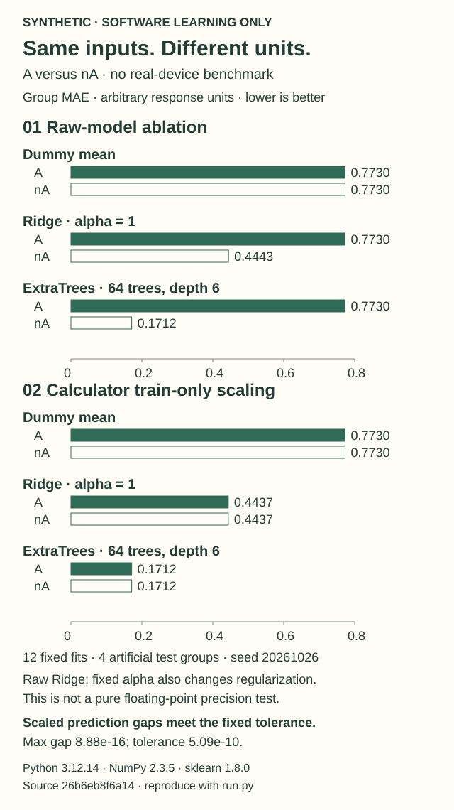

# Same current, different units

A value written in amperes or nanoamperes contains the same information. A model's
numerical implementation may not treat the two representations identically.
This example makes that distinction visible—and checks the preprocessing that
ML Super Calculator already uses.

**This is an invented, already-exposed toy fixture.** It is a runnable teaching
example, not a fresh held-out experiment, semiconductor benchmark, new method,
or evidence of causal or real-device generalization. The raw models are deliberate
ablations; they are not the Calculator's production pipeline.



## Run it locally

From a source checkout containing this example, with the Calculator's dependencies
already installed:

```sh
PYTHONPATH=src python examples/numeric-unit-equivalence/run.py --output unit-demo
```

These are Unix-like shell commands. This reference example requires **scikit-learn
1.8.0** and the recorded `groupbench/model.py` source hash. The Calculator itself
supports a broader dependency range. A different version/source is rejected before
fitting rather than silently presented as the same validation. No packages,
datasets, models, or credentials are downloaded by the runner.

It fits exactly **12 small models**, on one CPU thread: three families × two
preprocessing arms × two representations. On Linux the process has a 600 CPU-second
limit. That OS-specific limit is not enforced by this script elsewhere; no Windows
runtime verification is claimed. The output directory must not already exist.

For a no-fit look at the data:

```sh
python examples/numeric-unit-equivalence/generate_synthetic.py --output toy-current.csv
```

## What stays fixed

- Seed `20261026`; 384 rows in 12 artificial groups of 32 rows.
- Draw order: `u ~ Uniform(0,1)`, 12 group offsets `~ Normal(0,0.10)`, then
  384 noise values `~ Normal(0,0.05)`.
- `current_A = 1e-9 * (1 + 9*u)`; `current_nA = current_A * 1e9`.
- One unchanged target in arbitrary response units:
  `2 + 3*u + 0.7*sin(6*pi*u) + group_offset[group] + noise`.
- Groups 0–7 train; groups 8–11 evaluate. Neither group ID nor latent `u` is a feature.
- Dummy mean; Ridge `alpha=1, solver='lsqr'`; ExtraTrees with 64 trees,
  depth 6, minimum leaf size 2, seed `20261026`, `n_jobs=1`.
- Raw arm: direct estimators. Scaled arm: the actual Calculator pipeline, including
  median imputation and `StandardScaler`, fitted on training rows only.
- No tuning, model selection, seed search, or retries to improve the table.
  Every prediction is produced before evaluation-target scoring starts.

The fixed scaled-pair equivalence tolerance is
`1e-10 * max(1, max(abs(training_target)))`. The raw-tree diagnostic requires an
A/nA maximum prediction difference above `1e-6` and all 64 raw-A trees to have one
node. These are software diagnostics, not significance tests or effect-size claims.
A failed criterion produces exit code 1 and retained results; it is not a reason
to adjust this exposed fixture.

## Read the result, not just the bars

The figure compares **group MAE**: calculate MAE within each evaluation group, then
average the four groups equally. Here all groups have the same size, so row MAE
also agrees. Lower is better only for this artificial response function.

Prediction equivalence is a different measurement: the largest absolute difference
between A and nA predictions. Equal rounded MAE values do **not** prove matching
predictions. The summary retains full-precision gaps and the training-derived
threshold separately.

The saved reference run used Python 3.12.14, NumPy 2.3.5, pandas 2.2.3,
scikit-learn 1.8.0 and SciPy 1.17.0 on Linux. All twelve planned fits completed;
no seed, split, model, unit or threshold was changed to improve these results.

| Model | Preprocessing | A group MAE | nA group MAE | Maximum prediction gap |
| --- | --- | ---: | ---: | ---: |
| Dummy mean | Raw | 0.7730395516 | 0.7730395516 | 0 |
| Dummy mean | Calculator train-only scaling | 0.7730395516 | 0.7730395516 | 0 |
| Ridge alpha 1 | Raw | 0.7730395516 | 0.4442705289 | 1.382703164 |
| Ridge alpha 1 | Calculator train-only scaling | 0.4436723509 | 0.4436723509 | 8.881784197e-16 |
| ExtraTrees 64/depth 6 | Raw | 0.7730395516 | 0.1712322337 | 1.329733682 |
| ExtraTrees 64/depth 6 | Calculator train-only scaling | 0.1712322337 | 0.1712322337 | 0 |

Errors and gaps are in arbitrary response units. The fixed training-derived
prediction tolerance was `5.085524854499148e-10`.
All 64 raw-A trees were stumps; every scaled A/nA pair met that tolerance.
This is a positive check of the existing preprocessing on this fixture, not a
new product fix or a general recommendation to rank these model families.

Inspect the [full-precision summary](reference/summary.json),
[all predictions](reference/predictions.csv), [synthetic fixture](reference/synthetic_fixture.csv),
and [source/version/cost provenance](reference/provenance.json).
[SHA256SUMS](reference/SHA256SUMS) binds these selected reference files. They are a
public results snapshot, not a replacement for a complete local run directory.
Other dependency versions were compared with the pre-run record after execution
and matched; only the sklearn version and model source were enforced by the runner
before fitting. This ordering limitation is retained rather than hidden by a rerun.

## Why these differences are plausible

For scikit-learn 1.8.0, the tree partitioner defines an absolute `1e-7` feature
threshold. The random splitter can treat sufficiently small feature ranges as
constant, and ExtraTrees converts inputs to `float32`. That makes a raw current
range of roughly 1–10 nA, expressed in A, a useful numerical illustration—not a
new discovery. See the version-pinned [threshold definition](https://raw.githubusercontent.com/scikit-learn/scikit-learn/1.8.0/sklearn/tree/_partitioner.pxd),
[random-split implementation](https://raw.githubusercontent.com/scikit-learn/scikit-learn/1.8.0/sklearn/tree/_splitter.pyx),
and [ExtraTrees input documentation](https://scikit-learn.org/1.8/modules/generated/sklearn.ensemble.ExtraTreesRegressor.html).

**Ridge needs a separate explanation:** keeping alpha fixed while changing feature
units changes the regularization problem. Its raw A/nA difference is not a pure
floating-point ablation. Dummy is the unit-independent control. The example does
not establish that standardization is sufficient for all numerical ranges, large
offsets, nearly constant features, or future library versions.

The existing [Calculator preprocessing source](https://github.com/xinhi6716/ml-super-calculator/blob/26b6eb8f6a149d760aec0aff1fbd680f0f32dbb6/src/groupbench/model.py)
already keeps learned transformations inside the fitted pipeline. This companion
does not change that pipeline or claim to fix a newly discovered product defect.

## Redraw the figure without fitting

The renderer uses only a completed summary; it does not train a model. Choose a new
SVG path (and a new companion `.mapping.json` path):

```sh
python examples/numeric-unit-equivalence/render_figure.py \
  --summary unit-demo/summary.json --out unit-demo/unit-equivalence.svg \
  --source-ref 26b6eb8f6a149d760aec0aff1fbd680f0f32dbb6
```

It refuses nonfinite values, values outside the documented axis, and existing
outputs rather than clipping a bar or overwriting evidence. The mapping JSON binds
the input summary hash, numeric values, and output figure. This source reference
identifies the product baseline, not a new scientific dataset.

## Files and completion checks

A run creates:

| File | What to inspect |
| --- | --- |
| `synthetic_fixture.csv` | Original row/group/split identities, both input units, unchanged target |
| `predictions.csv` | All 128 evaluation rows and all 12 prediction columns |
| `summary.json` | Errors, full-precision unit gaps, parameters, scaler statistics, tree nodes, versions, package-source hashes |
| `cost.json` | Measured CPU/wall time, timing boundary, thread and CPU limits |
| `manifest.json` | Completion marker and hashes of generated files |
| `run-started.json` | Start marker; **not** proof that fitting or output completed |

An exception may leave `failure.json`. A hard CPU kill or other process interruption
cannot reliably run an exception handler; absence of `manifest.json` means an
incomplete run, even if some output files exist. Keep failures rather than replace
files or silently rerun. Exit 2 means the run was rejected or did not complete.

The focused tests do not fit estimators:

```sh
PYTHONPATH=src python -m unittest discover -s tests -p test_numeric_unit_equivalence.py -v
```

They check generator order, unit identity, grouping, pipeline construction,
mocked fit scheduling, arithmetic, and no-overwrite behavior. Passing them is not
an independent model refit or scientific replication.
